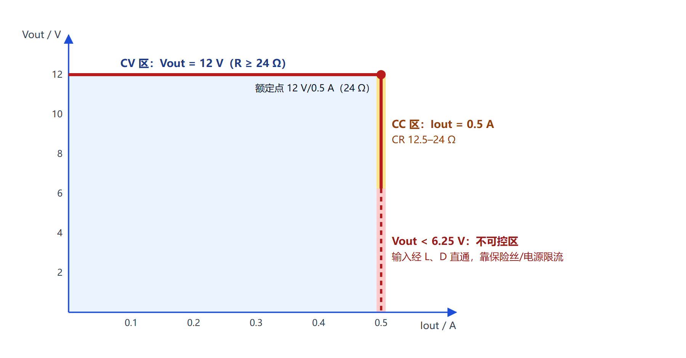
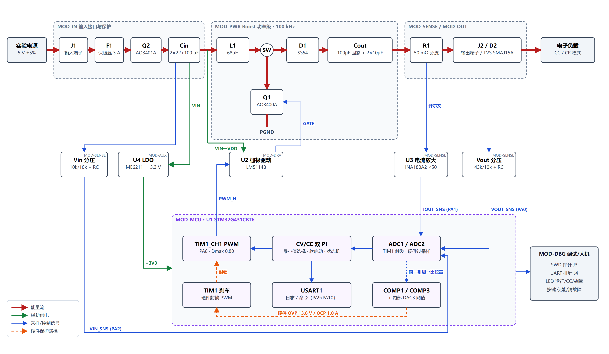
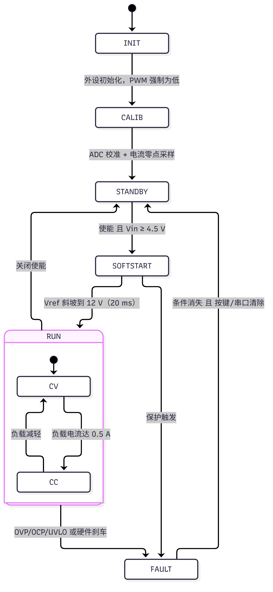
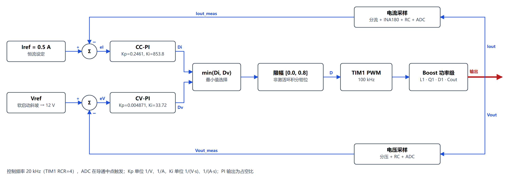
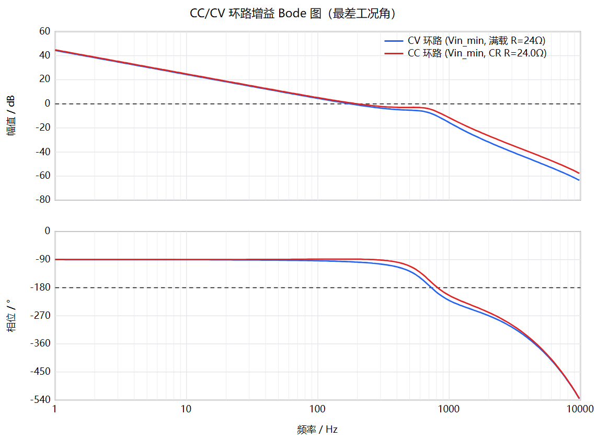

# 模块一 系统总体设计报告 — MCU 控制的 Boost 恒流恒压电源

> 版本 r1 ｜ 2026-11-09 ｜ 生成方式：系统设计智能体 `$boost-system-design`（Codex skill）
> 设计状态：**ready_for_downstream**（系统设计规则检查 73 PASS / 1 WARN / 0 FAIL）
> 数据来源：所有数值均来自工具输出 `calc.json / selection.json / losses.json / loop.json / check.json`，
> 完整表格见同目录 `report_tables.md`（表 A–H）。“计算值”均为理论/模型结果，**尚未实测**。

---

## 0. 摘要

| 项目 | 结论 |
|---|---|
| 拓扑 | 非同步 Boost（低边 N-MOSFET + 肖特基），100 kHz |
| 控制器 | STM32G431CBT6（170 MHz Cortex-M4F，片内比较器 + DAC → TIM1 刹车） |
| 控制方式 | CV/CC 双数字 PI 最小值选择，控制频率 20 kHz，Dmax = 0.80，软启动 20 ms |
| 关键功率器件 | L1 68 µH MWSA1206S-680MT ｜ Q1 AO3400A ｜ D1 SS54 ｜ Cout 25SVPF100M + 2×10 µF ｜ 驱动 LM5114B |
| 采样 | Vout 分压 43k/10k；Iout 高边 50 mΩ + INA180A2（×50）；Vin 分压 10k/10k |
| 保护 | 软件 OVP 13.2 V / OCP 0.6 A；硬件 OVP 13.8 V / OCP 1.0 A（COMP→刹车）；TVS SMAJ15A；3 A 保险丝；PMOS 防反接 |
| 额定点效率（计算） | **85.6 %**（含控制电路；功率级 88.2 %），课程目标 ≥ 75 % |
| 输出纹波（计算） | 0.47 %（55.8 mV，不含开关尖峰），课程建议 ≤ 3 % |
| 环路（模型） | CV：fc 159–190 Hz，PM ≥ 83°，GM ≥ 6.3 dB；CC：fc 93–200 Hz，PM ≥ 91°，GM ≥ 6.1 dB（全部工况角） |
| 交接文件 | `design_spec.json`、`bom_module1.csv`（全部带立创编号）、`boost_params.h`、系统框图 `.mmd` |

---

## 1. 需求解析

### 1.1 需求矩阵
智能体的输入为 `inputs/course_requirements.json`，由课程文件“四、设计参考”与 2.1 节整理，每项标注约束强度（must = 基本要求，target = 建议目标）与原文出处。需求编号、对应功能块、检查项与测试见 **表 A**。

| 编号 | 需求 | 约束 | 设计取值 |
|---|---|---|---|
| REQ-VIN | 输入 5 V，±5% | must | 4.75 / 5.00 / 5.25 V 三个工况角 |
| REQ-VOUT | 输出 12 V，稳态误差 ≤ ±5% | must | 12 V |
| REQ-IOUT | 恒流 0.5 A，稳态误差 ≤ ±5% | must | 0.5 A |
| REQ-PWR | 额定约 6 W，连续运行 | must | 12 V × 0.5 A = 6 W（一致性已校核 SR01） |
| REQ-FSW | 50–100 kHz，建议 100 kHz | must/target | 100 kHz |
| REQ-RIP | 纹波 ≤5%，建议 ≤3% | must/target | 设计目标 1% |
| REQ-MCU | 32 位 MCU，推荐 STM32 | must | STM32G431CBT6 |
| REQ-CTRL | 数字 PI，CC/CV | must | 双 PI 最小值选择 |
| REQ-PROT | 过压、过流、占空比限幅；建议软启动 | must/target | 三层保护 + 软启动 |
| REQ-EFF | 实测效率，额定点尽量 ≥75% | target | 计算 85.6%，待实测 |
| REQ-LOAD | 电子负载 CC/CR | must | 见 1.2 测试方式 |
| REQ-PCB | 两层板，功率/控制分区 | must | 交接 PCB 布局要点 |
| 项目约束 | 做实物、手工焊接、嘉立创 EDA、立创商城采购 | 小组确认 | 器件须带立创编号、可手焊封装 |

### 1.2 隐含约束（需求解析的关键发现）

1. **CC 与 CV 是两个工作区，不是同时满足的两个指标。** 额定点 12 V/0.5 A 对应 R = 24 Ω：
   R > 24 Ω 时为 CV 区（输出 12 V，电流 < 0.5 A）；R < 24 Ω 时为 CC 区（电流 0.5 A，电压 = 0.5·R）。
2. **非同步 Boost 的 CC 区有下限。** PWM 关断时输入经 L、D 直通输出，Vo 不可能低于 Vin − VF。
   计算得 CC 可调最低输出 6.25 V，对应 **CR 负载 12.5–24 Ω**；更低阻值或短路时电流不受 PWM 控制，只能由输入保险丝/实验电源限流（calc CC1/CC2）。
3. **Boost 的大电流在输入侧。** 输入/电感平均电流 1.49 A（Vin,min），约为输出电流的 3 倍，输入端子、保险丝、电感按此设计（calc I1）。
4. **测试负载模式影响设计。** 电源 CC 模式 + 电子负载 CC 模式没有确定工作点；因此测 CV 用电子负载 CC 模式，测 CC 用 CR 模式（环路设计也按这两种负载建模）。
5. **轻载 DCM。** 负载 < 105 mA（R > 114 Ω）时进入断续模式，功率级增益下降；环路不失稳但响应变慢（calc L8）。



*图 1　输出工作区（CV 区、CC 区与不可控区）*

### 1.3 假设与冲突
无需求冲突。初算假设（η = 0.85、VF = 0.5 V、陶瓷电容直流偏压保持率 0.3 等）全部记录在 `design_choices.json`，并在阶段 7 用实际器件复核（η 复核 85.6%，偏差 < 3%，无需迭代）。

---

## 2. 系统功能划分

### 2.1 系统框图
红色粗线为能量流，绿色为辅助供电，蓝色为采样/控制信号，橙色虚线为硬件保护路径。可编辑源文件：`system_block.svg`（图）与 `system_architecture.mmd`（Mermaid）。



*图 2　系统框图（能量流/辅助供电/采样控制/硬件保护分色；由 draw_figures.py 依据 design_spec.json 生成，位号与 BOM 一致）*

### 2.2 功能块

| 编号 | 功能块 | 职责 | 实现 | 对应需求 |
|---|---|---|---|---|
| MOD-IN | 输入接口与保护 | 端子、保险丝、防反接/缓启动、输入滤波 | 硬件 | REQ-VIN, REQ-PROT |
| MOD-PWR | Boost 功率级 | 5 V → 12 V 能量变换 | 硬件 | REQ-VOUT/PWR/FSW/RIP/EFF |
| MOD-DRV | 栅极驱动 | 3.3 V PWM → 安培级栅极电流 | 硬件 | REQ-EFF |
| MOD-SENSE | 采样调理 | Vout/Iout/Vin 调理到 0–3.3 V | 硬件 | REQ-VOUT/IOUT/PROT |
| MOD-MCU | 控制核心 | ADC、PI、PWM、比较器保护、状态机、日志 | 硬件 + 固件 | REQ-MCU/CTRL/PROT |
| MOD-AUX | 辅助电源 | 3.3 V（同时为 ADC 基准） | 硬件 | REQ-MCU |
| MOD-OUT | 输出接口 | 端子、TVS、测试点 | 硬件 | REQ-PROT/LOAD |
| MOD-DBG | 调试/人机 | SWD、UART、LED、按键 | 硬件 + 固件 | 调试需求 |

### 2.3 软硬件分工
- **硬件负责**：能量变换、信号调理、μs 级保护（比较器 → TIM1 刹车，与软件运行状态无关）、最后防线（TVS、保险丝）。
- **固件负责**：采样换算、CV/CC 闭环、软启动、慢速保护（OVP/OCP/UVLO 的软件阈值、延时与锁存）、状态机、日志与命令。

### 2.4 系统状态机



*图 3　系统工作状态机*

---

## 3. 拓扑选择

| 方案 | 优点 | 缺点 | 结论 |
|---|---|---|---|
| **非同步 Boost** | 结构最简；单路低边 PWM；轻载自然 DCM，无反向电流；调试风险低 | 二极管损耗约 0.24 W（≈4%） | **采用** |
| 同步 Boost | 效率高 2–3% | 需高边驱动/自举、死区、轻载反流管理，固件复杂、炸管风险大 | 不采用（可作扩展） |
| SEPIC / Buck-Boost | 输出可低于输入，可真正对短路限流 | 多一个电感/耦合电容，效率与成本更差 | 不采用：Vin 始终低于 Vo |
| 专用 Boost 控制 IC | 现成、稳定 | 闭环在 IC 内部，不满足“MCU 数字 PI”要求 | 排除 |

**理由**：输入 4.75–5.25 V 恒低于输出 12 V，升压拓扑即可；效率目标 75% 对二极管损耗有足够余量（计算效率 85.6%）；非同步方案把课程重点放在 MCU 采样与控制上，而非复杂的功率时序。
**适用边界**：CC 区下限 6.25 V；输出短路不可由 PWM 限流（见 1.2）。
**开关频率 100 kHz**：采用课程建议值。170 MHz 定时器下每周期 1700 计数（10.7 bit），1 LSB 对应 Vout 约 20 mV（< 0.2%）；更高频率会增加开关损耗并降低分辨率。

---

## 4. 控制方案

### 4.1 控制结构：双 PI 最小值选择



*图 4　CC/CV 双 PI 最小值选择控制框图*

两个 PI 每拍都计算占空比，取较小者输出：负载轻时 CV 环输出较小，由 CV 主导；负载电流达到 0.5 A 时 CC 环输出变小并接管，模式切换自然，无需额外判断。
**抗积分饱和**：非激活环的积分器钳位到当前实际输出，切换时不产生跳变。
备选方案（电压外环 + 电感电流内环）需要电感电流采样和 100 kHz 内环，作为扩展方向。

### 4.2 采样与时序

| 项目 | 取值 | 依据 |
|---|---|---|
| PWM | TIM1_CH1（PA8），100 kHz 边沿对齐，ARR = 1699 | calc T1 |
| ADC 触发 | TIM1 TRGO2，导通区间中点（避开开关沿振铃），硬件过采样 | design_rules §4 |
| 控制频率 | 20 kHz（TIM1 RCR = 4，每 5 个 PWM 周期） | calc T3 |
| CPU 占用 | 约 17.7%（按 1500 周期/次保守估计） | calc T4 |
| 日志串口 | 115200 bps，48 B × 50 Hz，占用 20.8% | calc T5 |

### 4.3 占空比限幅、软启动
- **Dmax = 0.80**：最坏工况（Vin,min、η = 0.75）需要 0.70，加 0.05 余量后取整到 0.80。复核结果：实际最大占空比 0.638，含损耗的升压比峰值点在 D = 0.914（SR20/SR21 PASS），因此过载时不会越过峰值点导致环路反向。
- **Dmin = 0**：允许跳脉冲，避免空载时最小占空比持续把能量泵向输出。
- **软启动**：参考值从当前 Vout（≈ Vin − VF）开始，20 ms 斜坡升到 12 V。

### 4.4 分层保护

| 层 | 保护 | 阈值 | 动作 | 响应 |
|---|---|---|---|---|
| L1 软件 | OVP | 13.2 V（+10%），ADC 码 3091 | 关 PWM 并锁存 | 50 µs 级 |
| L1 软件 | OCP | 0.6 A（+20%），持续 10 ms | 关 PWM 并锁存 | ms 级 |
| L1 软件 | UVLO | 4.3 V 关断 / 4.5 V 恢复 | 停机 | ms 级 |
| L2 片内硬件 | OVP | 13.8 V（+15%），DAC 码 3231 | COMP3 → TIM1 刹车 | 百 ns 级 |
| L2 片内硬件 | OCP | 1.0 A，DAC 码 3102 | COMP1 → TIM1 刹车 | 百 ns 级 |
| L3 无源 | 输出 TVS | VBR,min 16.7 V，钳位 24.4 V | 吸收过压能量 | — |
| L3 无源 | 输入保险丝 | 3 A 快熔 | 短路时切断 | — |
| L3 无源 | 防反接 | AO3401A PMOS | 反接时截止 | — |

阈值次序已校核：12 < 13.2 < 13.8 < 16.7 V（TVS VBR,min）；TVS 钳位 24.4 V < MOSFET 30 V（SR30–SR32）。
硬件 OCP 动作时电感电流约 2.76 A，低于电感 Isat 3.6 A（SR34）。
**注意**：封锁 PWM 并不能断开输出。非同步 Boost 关断后，输入仍经 L、D 给输出供电。

### 4.5 环路设计（PI 初值）
`loop_design.py` 建立了含寄生参数的 Boost CCM 平均小信号模型（电感 DCR、MOSFET 热态 Rds、二极管分段线性模型、各电容支路 ESR），并计入 RC 采样滤波、一拍计算延迟和零阶保持。在 **12 个 CV 工况角**（3 个 Vin × 满载/半载/轻载/电子负载 CC 模式）和 **9 个 CC 工况角**（3 个 Vin × CR 12.5/18.2/24 Ω）上网格搜索 PI 参数，要求每个角都满足 PM ≥ 45°、GM ≥ 6 dB，并在此前提下使最差角的穿越频率最高。

| 环路 | Kp | Ki | Ki·Ts（固件用） | 穿越频率 | PM | GM |
|---|---|---|---|---|---|---|
| CV | 0.004871 /V | 33.72 /(V·s) | 0.001686 | 159–190 Hz | 83–88° | 6.3–8.0 dB |
| CC | 0.2461 /A | 853.8 /(A·s) | 0.04269 | 93–200 Hz | 91–96° | 6.1–6.8 dB |



*图 5　CC/CV 环路增益 Bode 图（各自最差工况角）*

**解读**：LC 谐振频率 f0 ≈ 680–760 Hz（随 D 变化），RHPZ 频率 ≥ 7.4 kHz（满载、Vin,min）。限制带宽的是**谐振处的增益裕度**（固态电容 ESR 仅 24 mΩ，阻尼弱），而非 RHPZ。因此采用积分主导、穿越频率低于谐振的设计。
**局限**：以上为平均模型下的初值，DCM 轻载不在模型内；须由模块四仿真或实测确认（阶跃负载、CV↔CC 切换）。完整工况角数据见 **表 F**。

---

## 5. 关键参数计算
全部由 `calc_boost.py` 计算，“公式 → 代入 → 结果”完整记录见 **表 B**（45 项）。主要结果如下：

| 类别 | 参数 | 结果 | 公式/依据 |
|---|---|---|---|
| 工作点 | 理想占空比（Vin,min） | 0.604 | D = 1 − Vin/Vo |
| | 计及效率占空比（Vin,min） | 0.664 | D ≈ 1 − η·Vin/Vo |
| | 输入平均电流（最大） | 1.49 A | Iin = Po/(η·Vin) |
| 电感 | 电感需求 / 选取 | 70.1 → **68 µH** | L ≥ Vin·D/(fsw·r·Iin)，r = 0.35，最坏角 Vin,max |
| | 纹波峰峰值（L 取 −20%） | 0.58 A | ΔIL = Vin·D/(fsw·L) |
| | 峰值 / RMS 电流 | 1.78 / 1.50 A | IL,pk = Iin + ΔIL/2 |
| | Isat / Irms 需求 | ≥ 2.22 / ≥ 1.80 A | ×1.25 / ×1.2 裕量 |
| | DCM 临界负载 | 105 mA | Io,crit = ΔIL/2·(1−D) |
| 开关/二极管 | MOSFET 耐压需求 | ≥ 21.5 V | 1.5×(Vovp,hw + VF) |
| | MOSFET RMS 电流 | 1.22 A | √D·IL,rms |
| | 二极管反压需求 / 平均电流 | ≥ 20.7 V / 0.5 A | 1.5×Vovp,hw；ID = Io |
| 电容 | 输出有效电容需求 | ≥ 55.3 µF | C ≥ Io·D/(fsw·ΔVo/2)，ΔVo = 1% |
| | 输出 ESR 上限 | ≤ 33.8 mΩ | (ΔVo/2)/IL,pk |
| | 输出纹波电流 | 0.70 A | Io·√(D/(1−D)) |
| | 输入电容需求 | ≥ 15.2 µF | ΔIL/(8·fsw·ΔVin) |
| 采样 | Vout 分压 / 满量程 / 分辨率 | 43k/10k，17.5 V，4.27 mV | 满量程 ≈ 1.15×Vovp,hw |
| | Iout 互阻 / 满量程 / 分辨率 | 2.5 V/A，1.30 A，0.32 mA | 在 Rs·G 组合中选使 IFS ≥ 1.25 A 且损耗最低 |
| | Vin 分压 / 满量程 | 10k/10k，6.6 V | |
| | 滤波电容 | 2.2 nF / 3.3 nF（fc ≈ 9–10 kHz） | fc ≈ fsw/10 |
| 辅助电源 | 3.3 V 负载 / LDO 损耗 | 39.3 mA / 77 mW | MCU 30 mA 等 |

---

## 6. 主要器件选型

### 6.1 方法：知识库 + 规则筛选 + 评分
1. **结构化知识库** `knowledge/parts_db.json`：共 61 个候选器件。每个参数都带原厂数据手册 URL、页码/表号和测试条件；立创编号附搜索证据。数据由检索得到，**不凭记忆填写**。这对应参考论文中用 RAG 抑制器件参数幻觉的做法。
2. **硬性规则**：额定值对照计算需求（含裕量）、可手焊封装、立创可购、数据可信度（未读到原厂手册的器件不能入选）。缺数据按不通过处理。
3. **评分**：按类别计算损耗/误差/价格/电压余量；评分相差 10% 以内视为等价，再按价格和供货优先。

### 6.2 有代表性的淘汰（完整理由见表 E）
- **Si2302**：Vds 只有 20 V，低于 21.5 V 的需求。
- **SS14、B5819W**：IF(AV) 1 A，低于 1.78 A 的峰值。
- **MDD SS34、CD54 电感**：没读到原厂手册（confidence = low）。
- **11 个电感候选中 9 个被淘汰**：Isat 或 Irms 不足，例如 SRR1260-680M 只有 2.1 A，低于 2.22 A；47 µH 的不满足电感量需求。通过的 2 个中，68 µH 的 DCR 更低（140 vs 200 mΩ），因此入选。
- **UCC27517**：UVLO 开启电压最大 4.65 V，而驱动器最低供电约 4.6 V，可能无法启动。
- **EG27517**：手册没有 UVLO 规格。
- **MAX15070A**：电气性能最好，但立创不卖。
- **AMS1117-3.3**：手册只给了 0.8 A 时 1.3 V 的压差，余量不足（4.75 − 3.3 = 1.45 V）。
- **RT9013**：输入耐压不足 1.2×Vin,max，且处于停产阶段。

### 6.3 入选器件

| 位号 | 功能 | 型号 | 关键参数（条件见知识库） | 裕量 | 立创 |
|---|---|---|---|---|---|
| U1 | MCU | STM32G431CBT6 | 170 MHz，4×COMP，DAC3，FPU，LQFP48 | — | C529355 |
| Q1 | 开关管 | AO3400A | 30 V，Rds 32 mΩ max @4.5 V，Qg 6 nC | Vds 30/21.5 V | C20917 |
| D1 | 整流 | SS54 | 40 V/5 A，VF 0.55 V@5 A | VR 40/20.7 V | C22452 |
| L1 | 电感 | MWSA1206S-680MT | 68 µH，Isat 3.6 A（−20%），Irms 3.2 A，DCR 140 mΩ | Isat 3.6/2.22 A | C408532 |
| C20 | 输出储能 | 25SVPF100M（OS-CON） | 100 µF/25 V，ESR 24 mΩ，纹波 3.2 A | ESR 24/33.8 mΩ | C136279 |
| C10,C11 | 输出陶瓷 | CL31B106KAHNNNE | 10 µF/25 V X7R 1206 | 高频去耦 | C14860 |
| C1,C2 / C5 | 输入 | CL31A226KOHNNNE / EEE-FK1C101P | 22 µF/16 V ×2；100 µF/16 V | — | C90146 / C128532 |
| U2 | 驱动 | LM5114B（务必 B 版） | UVLO ≤ 4.0 V，VIH ≤ 2.4 V，7.6 A 灌 | 供电余量 0.6 V | C2676979 |
| R1/U3 | 电流采样 | PA2512 50 mΩ 1% / INA180A2 | 2 W；×50，共模 26 V | — | C375690 / C192764 |
| U4 | LDO | ME6211C33M5G | 压差 120 mV@100 mA，精度 ±1% | 余量 1.33 V | C82942 |
| D2 | TVS | SMAJ15A | VBR 16.7 V min，VC 24.4 V | > 13.8 V | C148216 |
| F1 | 保险丝 | 0466003.NRHF | 3 A，熔断 I²t 0.576 A²s | 浪涌 I²t 的 200 倍 | C14165 |
| Q2 | 防反接 | AO3401A | −30 V，60 mΩ @−4.5 V | — | C15127 |

**输出电容方案是由数据驱动的修正**：Murata 1206/25 V/X5R 的 22 µF 电容在 12 V 下实测只剩 27%（约 5.9 µF）。如果只用陶瓷电容满足 55 µF 的需求，需要 9 颗。改用 ESR 24 mΩ 的固态电容承担主要容量后，陶瓷电容只需 2 颗做高频去耦。

### 6.4 MCU 对比与引脚规划

| 型号 | 价格 | PWM 计数@100 kHz | 硬件保护比较器→刹车 | FPU | 晶振 | 引脚间距 | 评分 |
|---|---|---|---|---|---|---|---|
| **STM32G431CBT6** | ≈¥20.8 | 1700 | 有（4 个 + 内部 DAC3） | 有 | 不需要 | 0.5 mm | **22.8 入选** |
| STM32F334K8T6 | ≈¥22.3 | 1440（HRTIM 217 ps） | 有（2 个） | 有 | 需要 | 0.8 mm | 27.3 |
| STM32F103C8T6 | ≈¥5.6 | 720 | 无（需外加比较器） | 无 | 需要 | 0.5 mm | 32.6 |
| STM32G431KBT6 | ≈¥30.2 | 1700 | 有 | 有 | 不需要 | 0.8 mm | 35.2（缺货风险） |

引脚规划（依据 DS12589 Rev 6 引脚表，最终以 CubeMX 工程为准）：

| 信号 | 引脚 | 功能 |
|---|---|---|
| PWM_H | PA8（30） | TIM1_CH1 AF6 |
| VOUT_SNS | PA0（8） | ADC12_IN1 + COMP3_INP |
| IOUT_SNS | PA1（9） | ADC12_IN2 + COMP1_INP |
| VIN_SNS | PA2（10） | ADC1_IN3 |
| UART TX/RX | PA9（31）/ PA10（32） | USART1 AF7 |
| SWDIO / SWCLK / NRST | PA13（37）/ PA14（38）/ 7 | 调试 |
| BOOT0 | PB8（45） | 10 kΩ 下拉 |
| LED 运行/CC/故障，按键 | PB5 / PB9 / PB10，PB11 | GPIO |

待验证：同一引脚同时用作 ADC 输入和比较器输入，手册没有明确说明。上板验证；如果不行，备选方案是把 VOUT_SNS 再接到 PA7（COMP2_INP）。

---

## 7. 方案复核（用实际器件参数）

### 7.1 工作点与效率（表 C、表 D）

| Vin | D（含损耗） | IL 平均 | IL 峰值 | 整机效率 |
|---|---|---|---|---|
| 4.75 V | 0.638 | 1.38 A | 1.61 A | 85.0 % |
| 5.00 V | 0.617 | 1.31 A | 1.53 A | **85.6 %** |
| 5.25 V | 0.596 | 1.24 A | 1.47 A | 86.2 % |

额定点损耗 1.01 W，主要来自：
- 二极管导通 0.245 W
- 电感铜损 0.241 W（磁损按铜损的 25% 估计，0.06 W）
- 3.3 V 控制电路 0.197 W
- 防反接 PMOS 0.134 W
- MOSFET 导通 + 开关 0.069 W

效率假设 0.85 与复核结果 0.856 一致，无需迭代。

### 7.2 热、纹波、浪涌
- 结温（Ta = 40 °C，Vin,min）：MOSFET 47.8 °C，二极管 54.9 °C，PMOS 55.0 °C。
- 输出纹波：谐波叠加法得 55.8 mV（0.47%）。简化公式只得 30.1 mV，偏乐观，因为它忽略了 ESR 和各电容支路的分流。
- 上电浪涌：插入电源时输出电容经 L、D 谐振充电，峰值约 4.6 A，I²t = 0.0029 A²s，远小于保险丝熔断 I²t 0.576 A²s。
- 驱动器供电：4.75 − 1.49 A × 97 mΩ = 4.61 V，比 LM5114B 最坏情况的 4.0 V 高 0.6 V。

---

## 8. 系统设计规则检查（SDRC）
`check_design.py` 把需求、计算、选型、复核放在一起检查，共 74 项，类似 PCB 的 DRC：**73 PASS / 1 WARN / 0 FAIL**（表 G）。

| WARN | 内容 | 处理 |
|---|---|---|
| SR44 | 电流测量最坏误差约 4.0%（INA180 在 12 V 共模下失调最大 500 µV，对应 2%；增益误差 1%；分流电阻 1%），超过“稳态精度要求的一半”（2.5%）的预算 | **交接模块四**：固件做零点 + 满度两点标定（电子负载 0 A 和 0.5 A 两点），可消除失调和增益误差；同时在 STANDBY 状态下自动采样零点 |

---

## 9. 交接与验证计划

### 9.1 交接文件

| 文件 | 接收方 | 用法 |
|---|---|---|
| `design_spec.json` | 模块二/三/四 | 唯一设计基线：功能块、网络名（nets）、接口（IF-01..08）、器件与连接、MCU 引脚规划、保护与控制参数、PCB 布局要点、测试计划、需求追踪 |
| `bom_module1.csv` | 模块二（嘉立创 EDA） | 位号、值、封装、**立创编号**、连接说明；通用阻容从嘉立创基础库按值选 |
| `boost_params.h` | 模块四 | PWM/ARR、采样换算系数、PI 参数（Kp、Ki·Ts）、Dmax、保护阈值与比较器 DAC 码值 |
| `system_architecture.mmd` / `operating_states.mmd` / `control_loop.mmd` | 全组/报告 | 系统框图、状态机、控制框图 |
| `bode_loops.png` / `bode_*.csv` | 模块四 | 环路初值依据与对照 |

### 9.2 PCB 布局要点（给模块三）
1. 高 di/dt 回路 Q1(D)–D1–C10/C11–Q1(S) 面积最小，陶瓷电容紧贴 D1 阴极与 Q1 源极。
2. SW 节点铜皮够用即可，远离采样走线与 MCU。
3. 功率地与信号地在输出电容负端/分流处单点汇合，底层整面铺地。
4. R1 开尔文连接，差分走线到 U3；VOUT_SNS 从输出端子处取。
5. U2 紧靠 Q1；栅极串 10 Ω，对地 10 kΩ 下拉。
6. 测试点：SW、GATE、VOUT、IOUT_SNS、VOUT_SNS、PWM_H、GND 钩；SWD/UART 排针。

### 9.3 测试计划（表 H）
共 11 项：T01 CV 精度、T02 CC 精度、T03 模式切换、T04 纹波、T05 效率、T06 OVP、T07 OCP、T08 占空比限幅、T09 软启动、T10 输入波动、T11 30 分钟连续运行。每项都有对应需求、测试条件和判据，状态均为“计划”。

---

## 10. 智能体实现说明（答辩用）

### 10.1 输入 — 处理 — 输出
- **输入**：`course_requirements.json`（课程指标 + 项目约束），`design_choices.json`（阶段 3/4 的决策及理由）。
- **处理**：九个阶段 S0–S9，每个阶段有对应的工具和产物（见 SKILL.md）。
- **输出**：设计报告和交接文件（第 9 节）。

### 10.2 分层编排（借鉴参考论文 §2.2）
- **任务编排层**：SKILL.md 把流程定义为有序阶段，在拓扑、控制、选型、交接等关键决策点向用户确认，没有确认就不进入下一阶段。
- **反应式执行层**：每个阶段内部都是“计划 → 调用工具 → 读取输出 → 判断 → 修正”。例如效率复核与假设相差超过 3% 时，自动更新 η 并重新计算；SDRC 不通过时，按回溯表退回对应阶段。
- 本次运行中实际发生的修正：
  1. 发现陶瓷电容降容严重，输出电容方案改为“固态电容为主 + 陶瓷去耦”。
  2. 发现 UCC27517 的 UVLO 不满足要求，补充检索低 UVLO 驱动器后改选 LM5114B。
  3. 发现 INA180 在 12 V 共模下失调较大，把电流测量误差列为警告并交接给固件做标定。

### 10.3 知识与幻觉抑制（借鉴论文 §2.4）
- **结构化知识**：器件库 `parts_db.json`，61 个器件，每个参数都带出处、页码和测试条件。
- **非结构化知识**：`design_rules.md`，包含工程规则和常见错误清单。
- **铁律**：数值只由脚本计算，器件只从知识库选取，缺数据的器件不能入选。

### 10.4 工具集
| 工具 | 作用 |
|---|---|
| `calc_boost.py` | 参数计算 |
| `select_parts.py` | 规则选型 |
| `loss_thermal.py` | 效率、热、纹波、浪涌复核 |
| `loop_design.py` | 环路设计 |
| `check_design.py` | 系统设计规则检查（SDRC） |
| `export_handoff.py` | 交接文件导出 |
| `run_all.py` | 一键运行 |
| `test_tools.py` | 7 项单元测试，与解析解对照 |

脚本只依赖 Python 标准库。

### 10.5 与参考论文的差异
论文面向 PCB 物理设计（KiCad API，级联 Buck），本模块面向系统方案设计。论文中的“设计验证（DRC）”在这里对应 SDRC，“物理操作工具”对应计算与选型工具。本模块没有实现论文中的向量检索 RAG，而是用带出处的结构化库加文本知识库，由智能体按需查阅。

---

## 附录：复现
```bash
cd .agents/skills/boost-system-design/scripts
set PYTHONIOENCODING=utf-8
python run_all.py ../../../../outputs/module1 --requirements ../../../../inputs/course_requirements.json
python -m unittest test_tools -v
```
