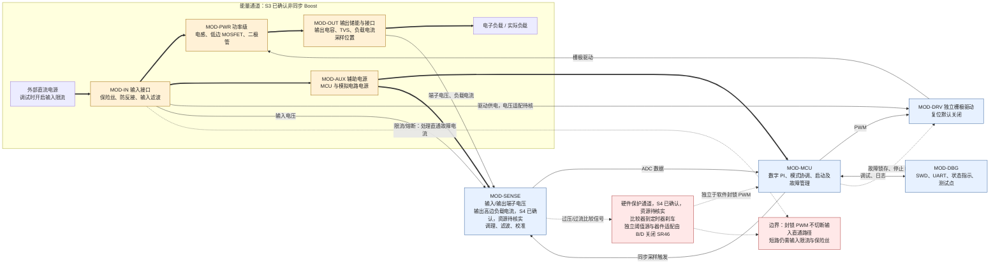
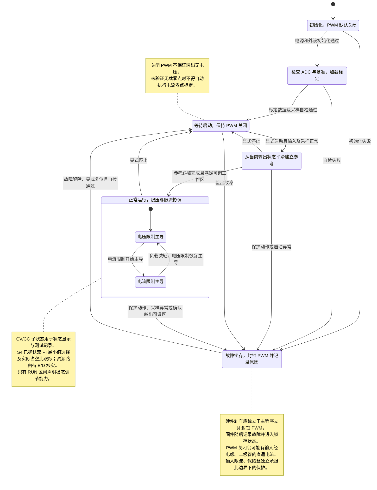
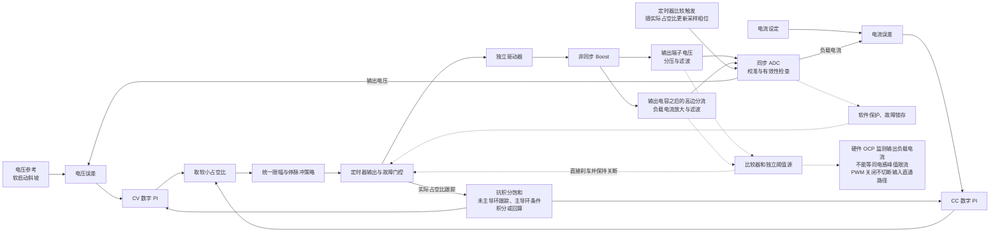
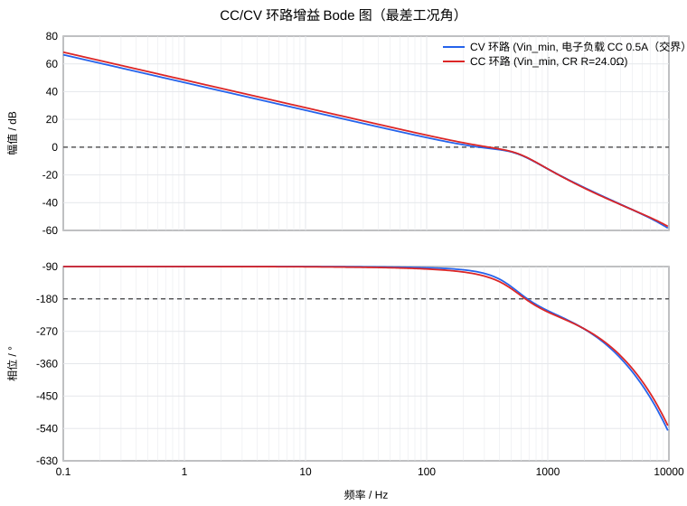

# 模块一 系统总体设计报告（交接版，r7）

工作目录：`outputs/r7/`（r6 保留在 `outputs/r6/` 供对照；r5 原工作目录 `outputs/test1/` 仅保存在本地，未入库）。需求来源：`inputs/course_requirements.json`，已原样复制为 `requirements.json`。

S1/S3/S4/S6 及 S7/S8 复核已获用户确认，最新“确认”授权 S9。S0–S9 已完成；报告与设计/计算/检查/交接文件均为 r7。r7 仅把 EDA 由嘉立创 EDA 改为 KiCad（全组决定，2026-11-11），增加 KiCad 符号/封装/引脚映射及其核对；全部计算数值与 r6（及 r5）相同，入选器件不变。SDRC 状态 conditional_review：系统设计资料已交接，保留实施关闭条件；尚无开关仿真或实测合格结论。

## 0. 摘要

本节概括设计结论和交接范围。本设计采用非同步 Boost、100 kHz PWM、所选 STM32G431CBT6，
以双 PI 最小值选择实现 12 V CV / 0.5 A CC；控制频率 20 kHz。
CC 规划输出 **6.25–12 V**，对应 **CR 12.5–24 Ω**；低于下限属于不可控区，不保证恒流。
验收 **CV 用电子负载 CC 模式，CC 用 CR 模式**。

额定整机效率计算 84.85%，所扫场景最低 83.92%；
最大纹波计算 0.7727%。实际导出 PI 密扫的最小 PM/GM：
CV 74.221°/6.119 dB，
CC 59.990°/6.185 dB。
这些仅覆盖所列 CCM 平均模型；DCM/空载及非线性切换待验证。

SDRC **96 PASS / 9 WARN / 0 FAIL**，状态 **conditional_review**（比 r6 多 18 项 SR12/SR13 KiCad 核对，其中 1 项 WARN）。
交接文件为 `design_spec.json`（含 `eda` 与 `components[].kicad`）、`bom_module1.csv`（含 KiCad 列）、`kicad/` 项目符号库、`boost_params.h` 和 `report_tables.md`；本报告解释依据及使用边界。
主要器件 BOM 尚需模块 B 补齐有依据的配套物料；引脚/保护资源暂未冻结，9 项工程事项在 §8、§9 继续跟踪。
计算、后续仿真和实测分开管理，本次未形成实测合格或无条件制造上电结论。

## 1. 需求解析

本节明确课程验收项目、建议目标和需要确认的工作边界。

### 1.1 需求矩阵

数值直接摘录需求文件；本阶段不填写推导值。must 表示基本要求，target 表示优化目标。出处定位到需求 JSON 字段，其 `origin` 保留课程原文或小组约束来源。

| 编号 | 要求 | 等级 | 出处（requirements.json） | 验证方法（计划） |
|---|---|---|---|---|
| REQ-IN | 输入直流 5 V，允许 ±5% 波动 | must | vin；课程“四、输入电压” | 在输入容差边界及标称点测试；边界由工具计算 |
| REQ-CV | 恒压设定 12 V，稳态误差不超过 ±5% | must | vout；课程“四、目标输出电压” | 电子负载 CC 模式，在恒压区扫负载并改变输入电压；端子处测压 |
| REQ-CC | 恒流设定 0.5 A，稳态误差不超过 ±5% | must | iout；课程“四、恒流目标” | 电子负载 CR 模式，在可调恒流区扫阻值并改变输入电压；测量实际负载电流 |
| REQ-PWR | 额定输出约 6 W，能够稳定连续运行 | must | pout；课程“四、额定输出功率” | 额定工作点持续带载并记录温升、稳态漂移；测试时长及环境条件在验证计划中明确 |
| REQ-FSW | 开关频率处于 50～100 kHz 范围 | must | fsw.range_hz、origin | 示波器测量 PWM 及开关节点 |
| TGT-FSW | 建议统一采用 100 kHz | target（字段内建议） | fsw.suggested_hz、origin | S3 论证后确定，并与实测频率比较 |
| REQ-RIPPLE | 输出电压纹波 ≤5% | must | ripple.max_pct、origin | 输出端短接地弹簧测量稳态峰峰值；明确带宽及工况，换算上限由工具计算 |
| TGT-RIPPLE | 输出电压纹波建议 ≤3% | target（字段内建议） | ripple.target_pct、origin | 同上述纹波测试，分别报告基本要求与目标达成情况 |
| REQ-MCU | 使用 32 位 MCU | must | controller.type、origin | 核对器件手册、选型记录和固件工程 |
| TGT-MCU | 优先 STM32 | target（字段内推荐） | controller.preferred、origin | S6 比较知识库内候选及资源适配性 |
| REQ-CTRL | MCU 数字 PI，实现 CC/CV 控制 | must | control | 核对控制结构、固件实现；进行负载阶跃和模式切换测试 |
| REQ-PROT | 具备过压、过流、占空比限幅保护 | must | protection.required | 阈值计算、故障注入、记录动作和锁存行为；区分 PWM 封锁与电源隔离 |
| TGT-START | 建议增加软启动 | target（字段内建议） | protection.suggested | 记录启动波形，检查电压和电流过冲 |
| REQ-ETA-MEAS | 完成效率实测 | must（origin 明确要求；父字段为 target） | efficiency.measure、origin | 同步测量输入与输出功率，报告仪器、工况及误差；不以计算代替实测 |
| TGT-ETA | 额定点效率尽量 ≥75% | target | efficiency.target_pct、level、origin | S7 损耗估算，实物阶段实测对照 |
| REQ-LOAD | 使用支持 CC/CR 模式的电子负载调试 | must | test_load | 核对设备能力，按电源当前工作区选负载模式 |
| REQ-PCB | 两层 PCB，功率级与控制级布局合理 | must（按字段 level） | pcb | 模块 C 检查层叠、功率回路、采样布线和接地 |
| REQ-BUILD | 制作实物、手工焊接 | 项目硬约束 | project_constraints.build_physical、assembly | 核对封装可焊性、装配计划与实物 |
| REQ-EDA | 原理图与 PCB 使用 KiCad（2026-11-11 由嘉立创 EDA 改） | 项目硬约束 | project_constraints.eda | 入选器件有 KiCad 官方库符号/封装且引脚一致（SR12/SR13）；模块 B/C 的 KiCad 工程可打开并通过 ERC/DRC |
| REQ-SOURCE | 立创商城采购；芯片由本模块选型 | 项目硬约束 | project_constraints.sourcing、origin | 从带数据手册与立创编号证据的 parts_db.json 筛选；采购前复查库存 |

### 1.2 隐含约束与工作区

- **额定工作点一致性**：额定功率、电压与电流必须落在同一工作点，由 S5 工具校验并计算交界负载。恒压与恒流是不同负载区间的限制行为，不要求在任意负载下同时维持两个设定值。
- **恒压区**：负载需求电流低于恒流设定时，由电压环维持电压。验证时使用电子负载 CC 模式，给定电流应处于恒压区。
- **恒流区**：负载变重后由电流环限制负载电流，输出电压随负载下降。验证时使用电子负载 CR 模式，负载阻值须落在拓扑实际可调范围。
- **低输出电压及短路区**：若 S3 采用非同步 Boost，PWM 关闭后输入仍可经电感及二极管到达输出，不能承诺降压恒流或短路恒流。短路风险须依靠输入限流、保险丝等独立措施处理；若要求主动切断，必须增加隔离开关或重新选择拓扑。
- **输入大电流侧**：输入电流由输出功率、效率和输入电压共同确定，不得按输出恒流设定直接选取电感、端子及输入保护。输入电流与器件应力见 S5/S7 的 §5、§7 工具计算。
- **轻载与空载**：应允许停止开关或跳脉冲，避免持续泵能引起过压；此区域的控制及保护行为在 S4 确定，平均模型结论需后续验证。
- **测试条件**：电源 CC 模式与负载 CC 模式不用于恒流稳态精度验收，以免两个恒流控制器相互争夺工作点。电子负载低压工作能力及吸收功率能力须在实物测试前核查。

工作区示意：CV 区 R>24 Ω，CC 规划区 R=12.5–24 Ω；下限外不保证恒流。


### 1.3 冲突、解释及已确认边界

| 编号 | 发现 | 本阶段建议处理 | 状态 |
|---|---|---|---|
| BND-01 | CC/CV 指标未写明是否要求覆盖任意负载及短路 | 按工作区分别验收；允许存在 Boost 的恒流调节下限；不要求短路恒流。具体下限由工具及器件复核决定 | 用户已确认 |
| BND-02 | 过流保护不能自动等同于短路断电 | 设计须明确软件/硬件封锁 PWM 的能力及直通电流路径；短路依靠输入限流与保险丝等独立措施，不把停止 PWM 写成切断输出 | 用户已确认 |
| BND-03 | ripple 的父级为 must，但含建议目标 | 纹波基本限值与建议目标分别验收，不把建议目标误写为硬性要求 | 用户已确认 |
| BND-04 | efficiency 的父级为 target，但 origin 要求完成实测 | 效率数值为优化目标，实测为必须完成的验证项目 | 用户已确认 |
| BND-05 | “稳定连续运行”未给时长与环境条件 | 不编造课程验收时长；后续验证计划明确测试条件和温升判定，并注明工程建议 | 后续验证计划关闭 |
| BND-06 | 需求仅提供来源文档名称，未提供本文档内容 | 本次以所指定 JSON 为需求基线，保留其 origin 追溯，不声称已独立核对原 DOCX | 本阶段声明 |

S1 已确认。用户进一步要求：报告必须给出 CC 输出电压下限及对应 CR 负载范围，明确低于该范围为不可控区；验收测 CV 用电子负载 CC 模式，测 CC 用 CR 模式。该补充已纳入 §1.5 和 §9 验证计划。S1 的确认不构成对拓扑、器件或控制参数的批准。

### 1.4 依据与数值管理

需求依据为本目录 `requirements.json`；方法依据为技能 `knowledge/design_rules.md` 的需求解析与拓扑限制条目。知识库中的示例数值不直接作为本次设计结果。所有派生数值在相应阶段由脚本生成，最终报告仅引用可追溯工具结果；当前无仿真值、实测值或合格结论。

### 1.5 CC 可调范围的明确交付项

采用已确认的非同步 Boost，S5 工具得到以下**计算规划范围**，S7 平均模型复核见 §7，实际适用性仍须验证：

| 项目 | 本次计算规划值 | 来源/说明 |
|---|---|---|
| CC 输出电压下限 | 6.25 V | calc.json.cc_range.vo_min_v；Vin_max + VF_assumed + margin |
| CC 输出电压区间 | 6.25–12.0 V | 上端为 CC/CV 交界；稳态规划工作区 |
| CR 负载范围 | 12.5–24.0 Ω | calc.json.cc_range.r_min_ohm / r_max_ohm；对应本次恒流设定 |
| 不可控区 | 低于 6.25 V 或 12.5 Ω | 本设计不保证恒流精度；含短路，依靠独立输入限流和保护 |

该下限是保守设计边界，不是输入直通的精确物理电压，不构成已实测证据。测 CV 用电子负载 CC 模式；测 CC 用上述范围内的 CR 模式。

## 2. 系统功能划分

本节把已确认需求分配到功能块，明确能量、采样、控制及保护的连接关系。

### 2.1 系统框图

独立图源为 `system_architecture.mmd`。图中粗箭头为能量流，普通实线为采样与控制信号流，虚线为保护或故障流。当前为功能架构：非同步 Boost 已获确认；比较器刹车、采样具体位置和驱动供电适配等按 S4 已确认决策及 S6 初选进一步核实。

外部输入经过 MOD-IN 送到 MOD-PWR，再经 MOD-OUT 向负载供能；辅助电源单独支持控制与采样。MCU 接收输入电压、输出端子电压及实际负载电流，计算 PWM，经独立驱动器控制 MOSFET。采样调理同时为硬件保护提供信号路径，硬件故障通道直接作用于定时器刹车，固件随后锁存和记录；无源输入保护独立承担 PWM 无法切断的直通故障电流。




### 2.2 功能块与需求映射

| 功能块 | 职责与实现方向 | 对应需求 |
|---|---|---|
| MOD-IN 输入与保护 | 输入端子、保险丝、防反接、滤波；按输入电流而非输出电流确定承载能力；调试电源开启限流 | REQ-IN、REQ-PWR、REQ-PROT、REQ-BUILD、REQ-SOURCE |
| MOD-PWR 升压功率级 | 电感、MOSFET、整流器件、储能及高频回路；电感峰值、饱和及耐压由工具核算 | REQ-IN、REQ-CV、REQ-CC、REQ-PWR、REQ-RIPPLE、TGT-RIPPLE、TGT-ETA |
| MOD-DRV 栅极驱动 | 独立驱动器将 MCU PWM 转换为栅极驱动；复位默认关闭；核对驱动器欠压锁定与输入电源压降 | REQ-FSW、TGT-FSW、REQ-CTRL、REQ-PROT、TGT-ETA |
| MOD-SENSE 测量与调理 | 测输入电压、输出端子电压及实际负载电流；分压、滤波、分流、放大、标定；已确认高边负载采样，资源路由待核实 | REQ-IN、REQ-CV、REQ-CC、REQ-PROT、REQ-ETA-MEAS |
| MOD-MCU 数字控制 | 32 位 MCU；数字 PI、PWM、ADC 同步、启动、限幅、故障管理；优先比较 STM32；双 PI 最小值选择；时序见已确认的 §4 | REQ-MCU、TGT-MCU、REQ-CTRL、REQ-FSW、TGT-FSW、REQ-PROT、TGT-START |
| MOD-AUX 辅助电源 | 稳压、去耦与模拟基准环境；核查输入容差和路径压降下的供电余量 | REQ-IN、REQ-MCU、REQ-CV、REQ-CC、REQ-PWR |
| MOD-OUT 输出接口与被动保护 | 输出储能、TVS、端子及负载采样位置；明确共地与接线；不默认具备输出隔离开关 | REQ-CV、REQ-CC、REQ-PWR、REQ-RIPPLE、TGT-RIPPLE、REQ-PROT、REQ-LOAD |
| MOD-DBG 调试与验证 | SWD、UART、状态指示及测试点；记录运行状态、校准及故障；外部仪表测功率和纹波 | REQ-LOAD、REQ-ETA-MEAS、TGT-ETA、REQ-CV、REQ-CC、REQ-PROT |
| 全模块工程约束 | 手工焊接、两层布局、KiCad 工程（符号/封装按 components[].kicad）、知识库内可追溯的立创料号；B/C 阶段验证实现 | REQ-PCB、REQ-BUILD、REQ-EDA、REQ-SOURCE |

本表覆盖 §1.1 的全部需求。测量与调试资源服务于验收，不将 MCU 日志值直接当作外部仪表的精度或效率测量结果。

### 2.3 软硬件分工

| 硬件承担 | 软件承担 | 联合验证内容 |
|---|---|---|
| 功率变换、栅极驱动、输入滤波与供电 | 数字 PI、参考值管理与占空比请求 | 负载稳态、转换损耗、PWM 与实际开关节点 |
| 采样调理、基准去耦、可用的同步触发资源 | ADC 调度、校准、数据有效性与合理性检查 | 采样相位、误差预算、零点与标定条件 |
| 比较器到定时器刹车的独立通道候选 | 软件保护、故障锁存、故障原因记录、显式恢复 | 软件失效时仍能封锁 PWM；硬件阈值及器件兼容性在后续阶段核实 |
| 保险丝、输入限流、防反接与 TVS | 不把软件停止当作输入或输出物理隔离 | 上电浪涌、负载突卸、直通短路路径及保护配合 |
| 调试接口、测试点及默认安全电平 | SWD/UART 支持、状态显示与测试记录 | 复位、启动、停止及故障时的实测波形 |

### 2.4 系统状态机

独立图源为 `operating_states.mmd`。主流程为 `INIT → CALIB → STANDBY → SOFTSTART → RUN(CV/CC)`。自检不通过、保护动作或经确认的越界进入 `FAULT`，封锁 PWM、锁存原因；故障解除且显式复位并通过自检后才能回待机。具体阈值与动作按 §4 已确认方案执行，滤波和实际延迟待后续核实，避免把轻载、启动瞬态误判为稳态越界。

CV/CC 子状态描述主导限制及显示状态；S4 已确认采用双 PI 最小值选择，子状态不替代实际占空比选择和抗饱和逻辑。硬件刹车不能依赖主程序进入 FAULT 后才动作。待机与故障状态均可能存在输入直通导致的输出电压。电流零点标定只有在确认无实际负载电流时执行，其余情况下加载已有标定并进行合理性检查。




## 3. 拓扑选择（S3 已确认，当前 revision r6，数值同 r5）

本节比较候选变换结构，并提出与已确认验收边界一致的功率拓扑与开关频率。

### 3.1 候选比较

| 候选 | 与本项目相关的优点 | 代价及边界 | 本次判断 |
|---|---|---|---|
| 非同步 Boost：低边 MOSFET + 整流二极管 | 单路 PWM，控制链清楚；功率级与驱动易分块调试；便于手工焊接和两层板实现 | 二极管有导通损耗；轻载进入非连续导通区；PWM 关闭仍存在输入直通，不能承诺低于输入电压的恒流或短路恒流 | **推荐提案**；符合已确认的分区验收边界。效率和热裕量必须经 S7 复核 |
| 同步 Boost：以受控开关替代整流二极管 | 有降低整流损耗的潜力 | 增加高边驱动、死区、开关时序及轻载反向电流管理；不能仅凭“同步”就假定有输出隔离 | 当前不选；若后续损耗复核不通过，可作为拓扑回溯候选 |
| SEPIC / 升降压结构 | 可将可调输出范围扩展到输入电压以下，适用于必须更低电压恒流的需求 | SEPIC 增加磁性或耦合器件及串联能量传递电容；其他升降压结构需分别评估驱动、损耗和短路路径；均增加本次实现负担 | 当前不选；用户已接受 Boost 可调下限，不需为未要求的降压工作区增加复杂度 |
| 自带闭环的专用 Boost 控制 IC | 内建调节及保护，可减少数字闭环开发 | 由 IC 完成稳压、MCU 仅设置目标或监视时，不能体现本项目 MCU 数字 PI 直接闭环；是否支持其他外部控制方式须逐器件确认 | 排除本次“内建闭环替代 MCU PI”的方案；独立栅极驱动 IC 仍允许使用 |

上述判断依据为需求文件及 `knowledge/design_rules.md` §2；不是对某个尚未选定料号的性能承诺。器件选择限于知识库，具体型号和立创编号在 S6 确定。

### 3.2 推荐结论与适用边界

建议在 `design_choices.json` 中采用 `topology = async_boost`。其能量通道是输入电感、低边功率开关、整流二极管和输出储能；MCU 经独立驱动器生成开关动作，CC/CV 由 MCU 数字 PI 实现。该方案与额定升压任务及已确认的工作区要求匹配。

必须保留三个边界：CC 只在 §1.5 工具计算并经验证的输出电压及 CR 负载范围内验收；低于此范围为不保证恒流的不可控区；封锁 PWM 不切断输入直通路径，短路由独立输入限流与保险丝等措施处理。防反接 PMOS 不自动等于具有故障检测的输入断路器。若新增主动短路隔离或低电压恒流需求，须回到 S3 比较，不修改文字来掩盖拓扑限制。

### 3.3 开关频率提案

建议采用 `fsw_hz = 100000`，即课程建议的 **100 kHz**，处于课程规定的 50～100 kHz 区间。相较区间内更低频率，该选择有利于减小实现相同纹波所需的储能元件，同时增加开关损耗并减少定时器每周期可用计数。当前不引用未选 MCU 的时钟或 PWM 分辨率作为已确认依据。

后续 S5 工具核算电感、纹波、PWM 分辨率和控制时序，S6 核对器件真实驱动条件，S7 计算开关损耗与热裕量。若不通过，依据检查结果回溯频率或拓扑，递增 revision 并重新提交确认。控制频率与 PWM 频率不同，S3 不批准模板中的控制频率、采样策略、限幅或保护阈值。

### 3.4 本阶段确认范围

用户已确认采用非同步 Boost 和 100 kHz 开关频率，S3 通过。S3 提案在 r2 落盘；r3 保留选择并记录确认、增加 §4，r4 纳入 S5/S6 的工具和证据修正，r5 完成 S7/S8 模型复核。控制结构、采样、时序、抗饱和、保护及软启动随后在 S4 单独确认，现已通过。

## 4. 控制方案（S4 已确认，当前 revision r6，数值同 r5）

本节确定 MCU 如何协调限压和限流，并明确采样、限幅及保护的可实现条件。以下数值是 S4 已批准的设计输入或预算假设，不是计算结果、器件保证值或实测值；计算派生量留待 S5–S7 工具输出。

### 4.1 控制结构与抗积分饱和

建议采用 `dual_pi_min_select`：CV-PI 与 CC-PI 并行计算占空比候选，选择较小者，再施加统一限幅与故障门控。误差分别使用校准后的电压、电流物理量，设定值来自需求文件；不直接用未经缩放的 ADC 码套用 PI 系数。图源为 `control_strategy.mmd`。

| 方案 | 判断及理由 |
|---|---|
| 双 PI 最小值选择 | 推荐。直接以输出端子电压和负载电流闭环，限压或限流先达到时由该环主导，适合本次分区验收 |
| 电压外环、电感电流内环 | 暂不采用。需要电感电流测量和更快的内环设计，当前输出电流测量不能直接替代电感电流反馈 |
| 单 PI 按模式切换 | 暂不采用。切换控制对象、误差单位及积分状态需额外处理，本项目优先避免硬切换带来的输出突变 |

未主导环的积分状态应跟踪**最终实际施加**的占空比，跟踪量包括限幅、停脉冲和保护门控的作用；主导环也采用条件积分或回算防止饱和。初始化及恢复时按当前测量与实际占空比建立积分状态。不能只把积分器钳位到固定最大值，也不能让未主导环持续累积。

具体跟踪实现及离散 PI 系数在程序模块落实；S7 工具给出初始 PI 参数，动态切换与抗饱和性能必须经后续仿真及实测确认。CV/CC 显示标记可加滞回或保持判据，但不得改变最小值限压限流的基本作用。




### 4.2 PWM、控制周期与采样时序

| 字段/决策 | S4 已确认决策 | 理由与后续核查 |
|---|---|---|
| `f_ctrl_hz` | 20000 Hz | 与已确认的 PWM 频率采用整数同步关系；给采样、双 PI 计算及通信留预算。控制更新频率不等于环路带宽，S7 搜索稳定 PI |
| `pwm_alignment` | edge，边沿对齐 | 单路低边驱动实现直接，较同一时钟下的中心对齐保留更多每周期计数；采样相位随占空比调整 |
| `timer_clk_hz`、`cpu_clk_hz` | 均按 170000000 Hz 作候选预算 | 知识库内 STM32G431 条目支持该时钟预算；S6 已初选 STM32G431CBT6，B/D 继续核对时钟树及供电条件，不把此预算套到其他 MCU |
| `isr_cycles_est` | 1500 cycles | 中断预算假设，覆盖数据处理和 PI；S5 计算 CPU 占用，程序实测最坏执行时间，超预算须回溯 |
| ADC 同步触发 | TIM1 可用比较事件映射 TRGO2，目标在实际导通区间中点启动采样 | 避开开关沿；触发比较值与 PWM 同步预装载，随实际占空比更新。S6/B/D 核对触发矩阵、可用通道和转换完成时限 |
| 采样与控制更新 | 可按 PWM 周期产生采样，以新鲜完整帧按整数周期抽取进行控制更新 | RCR 用于控制更新节奏，不能假定它自动分频所有比较触发；具体注入组或规则组加 DMA 路径由程序模块核实 |
| 计算及生效延迟 | 采用与 S7 模型一致的一拍计算延迟及保持 | 中断截止时刻、影子寄存器写入与生效边界须确定；增加多周期平均或其他滤波延迟后必须重算环路 |

当实际占空比为零或导通窗口容不下采样/建立时间时，改在远离开关沿的稳定区取样；不能向不存在的“导通中点”触发。电压与电流如顺序转换，需核对整个序列的采样时刻与窗口；可用并行 ADC 资源，但不提前承诺具体映射。数据过期、转换未完成或异常饱和时禁止继续用旧值闭环，并进入故障处理。比较器保护通道持续工作，不等待 ADC 中断。

硬件过采样和跨周期平均暂不计入已确认时序；新增后必须核查触发次数、总转换时长及延迟。实际定时器计数、RCR、ADC 码值与 CPU 占用由 S5 工具计算，本节不手算填入。

### 4.3 采样位置、量程与校准

建议输出电压从**负载端子侧**取样；输出电流采用高边分流加电流检测放大器，分流放在输出储能电容之后、外部负载之前，以测实际负载电流，不把输出电容充放电电流混为负载电流。两路负载地共地，分流电阻 Kelvin 引出。输入电压单独分压测量，用于欠压管理。

| 字段/决策 | S4 已确认决策 | 理由 |
|---|---|---|
| `adc_bits`、`adc_vref_v` | 12 bit、3.3 V | 与知识库 MCU 候选及模拟电源规划相容；S5 计算分辨率，VDDA 变化通过 VREFINT 校正 |
| `adc_usable_frac` | 0.95 | 给非理想摆幅及瞬态留量程余量；S5/S8 检查保护点是否超量程 |
| `vout_fs_over_ovp_hw`、`vin_fs_over_vin_max` | 均为 1.15 | 满量程规划高于关键阈值，避免到保护点就饱和；具体分压取标准值后再核查 |
| `divider_rbot_ohm` | 10000 Ω | 折中分压功耗、噪声及 ADC 驱动负担；S6/D 核查等效源阻抗和 ADC 建立时间 |
| `divider_filter_fc_hz` | 10000 Hz | 抑制开关噪声并控制采样相位滞后；S5 求实际标准电容，S7 纳入实际滤波极点 |
| `iout_fs_min_a` | 1.25 A | 留出高于硬件输出 OCP 提案的观察空间；最终满量程由增益和分流组合决定 |
| `csa_supply_v`、`csa_swing_to_rail_v` | 3.3 V、0.05 V 摆幅预留 | 是初算预算，S6 必须按实际器件输出摆幅、共模范围和负载条件核查，不能把供电限幅当作 ADC 引脚绝对额定保护 |
| `shunt_max_loss_w` | 0.05 W，在硬件 OCP 电流下计算 | 限制分流损耗及发热；不代表已选择该额定功率的电阻，实际额定功率和容差由 S6 筛选 |

增益与分流阻值候选列表沿用模板，工具从中计算组合，器件只能从知识库中匹配，不能凭候选列表虚构实际物料。电流通道也应有相适应的模拟滤波，其带宽及放大器动态必须与 S7 模型一致；不得使用未建模的慢滤波却仍宣称原 PI 裕度成立。

校准采用电压/电流零点与增益核查，电流零点仅在确认无实际电流时更新；待机不等于无输出或无电流。放大器失调须使用实际高边共模条件下的手册参数，量化误差在 S8 检查。ADC 与比较器复用同一引脚、独立阈值源是否可同时实现，S6/B/D 核查；未证实前保留独立比较器输入引脚的可行路线。

### 4.4 占空比限幅、软启动与 CC 下限

| 字段/决策 | S4 已确认决策 | 理由与回溯条件 |
|---|---|---|
| `dmin` | 0 | 允许停止开关/跳脉冲，避免空载仍持续输入能量；最小有效非零脉宽须在器件选定后核查 |
| `dmax_margin`、`dmax_step` | 均为 0.05，占空比绝对量 | 在工具计算的最坏需求之上留余量，按网格向上取上限；具体 Dmax 不是本阶段手填常数。S7/S8 必须同时通过所需增益和增益峰边界检查 SR20/SR21 |
| `soft_start_ms` | 20 ms | 作为参考斜坡的可调初值，降低突加开关能量；启动过冲和跟踪能力需实测，不是已验证最优时间 |
| 软启动起点 | 当前实测输出电压 | Boost 插电后可能已有直通预充电压；不从虚构的零输出状态开始积分。电流限制、抗饱和和保护全程有效 |
| `diode_vf_assumed_v` | 0.5 V 初算假设 | 用于 S5 估算，并非器件选型结论；S6/S7 对照知识库数据与损耗模型 |
| `cc_vout_min_margin_v` | 0.5 V 规划余量 | 工具按输入上限、初算二极管压降及余量规划可调下限；给正向调节留空间，不当作拓扑精确物理极限 |

S4 获批后，S5 已从同一 `design_choices.json` 生成 CC 输出电压下限、CR 负载上下限并填入 §1.5。低于该规划范围为本设计不保证恒流的不可控区；测 CC 只用范围内的 CR 负载。启动期间的预充和跨越下限不作为稳态精度工况；故障判据须区分启动状态、轻载状态与确实无法调节的运行越界。

数字参考软启动不能限制插电瞬间经电感和二极管对输出电容充电的直通浪涌。该浪涌须在 S7 计算，由实验电源输入限流及经栅极时序、线性区 SOA 核实的 PMOS 缓启动等措施处理；仅选了防反接 PMOS 不能证明浪涌已解决。输出已过压时不得正常软启动，待故障清除后再启动。

### 4.5 分层保护与阈值提案

| 层级/字段 | S4 已确认决策 | 动作及依据 |
|---|---|---|
| L1 `ovp_sw_pct` | 设定电压之上 10% | 检测超限后封锁 PWM 并锁存，正常精度区与异常区分开；不采用 OCP 的持续延时来延缓 OVP |
| L2 `ovp_hw_pct` | 设定电压之上 15% | 为软件动作留间隔，比较器直接作用定时器刹车，独立于主程序计算 |
| L1 `ocp_sw_pct`、`ocp_sw_delay_ms` | 设定电流之上 20%，持续 10 ms | 在正常 CC 限流之外检测持续异常并锁存，避免短暂噪声误触发；快速通道另由硬件承担 |
| L2 `ocp_hw_a` | 输出负载电流 1.0 A | 较软件阈值更高的独立快速封锁阈值；ADC 量程、放大器建立时间、电感故障应力须后续复核 |
| L1 `uvlo_off_v`、`uvlo_on_v` | 关闭 4.3 V，重新允许启动 4.5 V | 位于正常输入范围之外并留回差，减少欠压反复启停；S6/S8 仍须检查实际供电路径压降和驱动器 UVLO，不能只看输入端电压 |
| L3 输入保护 | 输入限流、保险丝、防反接 PMOS | 输入直通短路路径不能由 PWM 控制，保险丝需核查浪涌、熔断及器件承受能力配合 |
| L3 输出保护 | 配置 TVS | 作为瞬态钳位；需核对击穿、电流条件下钳位值与受保护器件耐压，不把 TVS 当作可长期吸收故障功率的稳压器 |

电压阈值和所有 ADC 码由 S5 输出。应满足 `Vset < OVPsw < OVPhw < TVS 最小击穿`，并核查 TVS 钳位和器件耐压；S6/S8 检查容差，不能仅凭名义值排好次序就认为有足够裕量。硬件 OCP、软件 OCP 与恒流设定也须按同一测量位置检查次序。

硬件比较器连接定时器刹车，故障期间保持关断，关闭自动输出重使能；故障解除后仅允许显式清除、自检、返回待机并软启动。输入从 UVLO 恢复只解除启动禁止，不自动恢复开关。各比较器所需独立 DAC 通道及路由须经 MCU 资源检查；ADC 码与 DAC 码的尺度、校准和阈值源不直接等同。

**保护能力边界**：本方案没有默认增加电感电流采样，输出高边 OCP 不是电感峰值逐周期限流。电感峰值异常或功率开关故障可能先于负载电流升高，必须复核饱和、输入限流及保护配合；SR34 的工具结果需逐项解释，必要时回溯器件或保护方案，不能用 WARN 掩盖缺乏保护的条件。PWM 关断后输入仍可经电感和二极管供电，故输出短路依然依赖独立输入保护。

### 4.6 环路目标与尚需关闭的实现项

建议设定 `pm_min_deg=45`、`gm_min_db=6`，作为 S7 对 CV/CC 工况角搜索 PI 初值的裕度门槛。由工具结合储能元件、寄生参数、模拟滤波及采样/计算延迟计算；S7 的 PI 初值、带宽、波特图和裕度见 §7.3。Boost 的右半平面零点与 LC 谐振限制可用带宽，控制更新率不直接等于可实现的闭环速度。

CCM 平均模型不能证明 DCM、空载、停脉冲及非线性限幅切换的稳定性，以上单列为后续仿真和实测任务。当前还需在后续阶段关闭：采样窗口和转换截止时间、ADC/COMP 并用和独立 DAC 路由、放大器及电流滤波动态、实际 CPU 最坏执行时间、故障电感应力与浪涌措施。

### 4.7 本阶段确认记录及执行顺序

用户已确认：双 PI 最小值选择及抗饱和、输出高边负载电流采样、同步采样与控制更新方案、占空比边界策略、分层保护阈值提案、软启动和 CC 规划假设。其他功率级、辅助电源及日志字段保留为后续预算初值，S5 计算、S6 选型和 S7 实际器件复核后再作为结果；不能提前认定最终器件参数。

确认后已完成 S5 参数计算与 S6 器件筛选，CC 电压和 CR 范围已填入 §1.5；S6 已获确认，S7/S8 结果见 §7–§8，S9 已获确认并生成交接文件。若后续计算或检查要求改动本次已确认的关键控制决策，记录原因、递增 revision，并重新提交相关决策。

## 5. 关键参数计算（S5 完成，revision r5）

工具输出为 `calc.json`，均为初算值，效率与二极管压降仍采用已登记假设，S7 实际器件复核另见 §7；不是仿真值或实测值。

| ID | 计算项 | 结果 | 公式/说明 |
|---|---|---|---|
| L1 | 电感量需求（最坏角） | 70.08 µH | L ≥ Vin·D/(fsw·r·Iin)；r=0.35 为纹波比；最坏角 Vin_max |
| L2 | 电感标称值（取标准值） | 68 µH | 取 ≥ (1−rounding_allowance)·L_req 的最近标准值；标准值向下取整允许 3%；r 为初算目标，负容差下实际纹波比须另行核查 |
| L4 | 电感峰值电流（最坏） | 1.776 A | IL,pk = Iin + ΔIL/2； |
| L5 | 电感 RMS 电流（最坏） | 1.495 A | IL,rms = √(Iin² + ΔIL²/12)； |
| L6 | 电感饱和电流需求 | 2.22 A | Isat ≥ k·IL,pk； |
| L7 | 电感温升电流需求 | 1.795 A | Irms ≥ k·IL,rms； |
| L8 | CCM/DCM 临界输出电流 (Vin_nom) | 0.1051 A | Io,crit = ΔIL/2·(1−D)；负载 < 105 mA（R > 114 Ω）可能进入 DCM，CCM 模型不适用，须另行验证 |
| C1 | 输出电容有效容量需求 | 55.3 µF | C ≥ Io·D/(fsw·ΔVc)，ΔVc = ΔVo/2；设计纹波 1.0%（120 mV）留余量于课程 ≤3% 建议值；电容放电与 ESR 各占一半 |
| C2 | 输出电容 ESR 上限 | 33.79 mΩ | ESR ≤ (ΔVo/2)/IL,pk；二极管电流在 0 与 IL,pk 间跳变，ESR 纹波 = IL,pk·ESR |
| C3 | 输出电容纹波电流 | 0.7022 A | IC,rms ≈ Io·√(D/(1−D))； |
| C4 | 输出电容耐压需求 | 20.7 V | VC ≥ k·Vovp,hw； |
| C5 | 输入电容需求 | 15.15 µF | Cin ≥ ΔIL/(8·fsw·ΔVin)；Boost 输入电流连续，仅需滤除三角纹波 |
| Q1 | MOSFET 耐压需求 | 21.45 V | Vds ≥ k·(Vovp,hw + VF)；以硬件过压点而非额定 12 V 作为应力基准 |
| Q2 | MOSFET RMS 电流 | 1.218 A | IQ,rms ≈ √D·IL,rms； |
| D6 | 最坏占空比需求 | 0.7031  | D = 1 − ηworst·Vin,min/Vo； |
| D7 | 占空比上限 Dmax | 0.8  | Dmax = ceil(Dworst + margin, step)；阶段 7 用实际寄生参数核对 Dmax 低于升压比峰值点 |
| T1 | PWM 周期计数值 | 1700.0 count | N = ftim/fsw；ARR = 1699；分辨率 10.7 bit |
| T3 | 控制周期 | 50.0 µs | Tc = 1/fctrl；TIM1 重复计数 RCR = 4，每 5 个 PWM 周期更新一次 |
| T4 | 控制中断 CPU 占用 | 17.65 % | load = cycles·fctrl/fcpu； |
| T5 | 调试串口带宽占用 | 20.83 % | load = bytes·10·rate/baud； |
| S2 | 输出电压分辨率 | 4.271 mV | LSB = VFS/(2^N−1)；12 V 对应码值 2810 |
| S4 | 电流采样电阻 × 放大倍数 | 2.5 V/A | 选 max(Rs·G) 使 IFS ≥ IFS,min 且 Rs·Iocp² ≤ Ploss,max；满量程 1.30 A；0.5 A 时采样电压 25 mV，ADC 输入 1.25 V |
| S5 | 输出电流分辨率 | 0.3223 mA | LSB = Vref/(Rs·G)/(2^N−1)；0.5 A 对应码值 1551 |
| PR1 | 软件过压阈值 | 13.2 V | Vovp,sw = Vo·(1+x%)；ADC 码值 3091 |
| PR2 | 硬件过压阈值 | 13.8 V | Vovp,hw = Vo·(1+y%)；同一电压在 ADC 通道的等效码值 3231；不是已验证 DAC 阈值码 |
| PR3 | 软件过流阈值 | 0.6 A | Iocp,sw = Icc·(1+z%)； |
| PR4 | 硬件过流阈值 | 1.0 A | 设定值；仅按稳态换算的电感平均电流约 2.97 A，不是故障瞬态上界；须复核饱和与保护协调 |
| CC1 | CC 模式最低可调输出电压 | 6.25 V | Vo,cc,min = Vin,max + VF + margin；Boost 关断时仍有输入经 L/D 的直通路径，电压随器件压降及负载变化；本规划式不是物理下限，也不保证短路恒流 |
| CC2 | CC 模式最小负载电阻 | 12.5 Ω | Rmin = Vo,cc,min/Icc；CR 测试 CC 段负载范围 12.5–24 Ω；更低阻值或短路依靠输入保险丝/电源限流 |
| A1 | 3.3 V 负载电流 | 39.3 mA | I = IMCU + ICSA + n·ILED + Imisc； |
| A2 | LDO 功耗 | 76.64 mW | P = (Vin,max − 3.3)·I； |

电感标准值为 68 µH，考虑负容差的有效电感为 54.4 µH；初算目标纹波比 0.35，负容差最坏实际值 0.4509，目标未满足。初选保留工具原有的标准值取整策略，将允许量 0.03 显式登记；不把标称值误写为严格大于计算需求。S7 复算电流应力、热和环路见 §7，仍未达到内部纹波比目标；若实物不满足，需修改并重跑。

输出分压 43000.0 Ω / 10000 Ω；工具给出输出电压分辨率 4.271 mV、额定 ADC 码 2810。电流通道 0.05 Ω、增益 50，可用量程 1.3 A；ADC 理论满量程 1.32 A，LSB 0.3223 mA、额定 ADC 码 1551。两种满量程分别描述模拟摆幅与 ADC 码阶，不能混算。

初算 CC 范围：**输出 6.25–12.0 V；电子负载 CR 12.5–24.0 Ω**。上端为 CC/CV 交界；低于 6.25 V 或 12.5 Ω 属于不可控区，不保证恒流。此为保守规划范围，S7 平均模型复核见 §7，实际精度和动态仍须验证。

## 6. 主要器件初选（S6 已确认，revision r5）

完整初选表、每类全部候选的淘汰原因、并列选择理由、手册参数/页码及采购证据见 selection_review.md（r5 审阅记录 selection_review.md，保存在本地 outputs/test1/，未入库）。所列数量只覆盖本阶段主要器件，不是完整装配 BOM。

采用双 PI 最小值选择的已确认架构，初选 MCU、独立低边驱动器、功率管、肖特基整流、电感、储能/去耦、电流采样、辅助电源与保护器件。所有类别都有硬性筛选通过项；完整 SDRC 条件复核见 §8。

选型保留的软性问题是 INA180A2 最大失调在额定电流下的贡献（见 selection_review），需要实际共模条件下标定并做全误差预算。电感实际纹波、输出 OCP 与电感故障应力、输入限流/浪涌、TVS 钳位裕量、LDO 全条件精度以及 MCU 模拟资源路由均保留复核项。SS54 的二级规格书与厂商浪涌额定差异单列，不能据此保证短路或浪涌安全。

S5/S6 工具修正与证据补齐在 `tooling/s6_changes.patch` 留有差异，r3 归档于 `history/r3/`；共享技能未改动。修改设计决策后必须升级 revision，并从相应工具重新生成文件。S6 已获确认，S7/S8 本轮完成；r4 及旧模型首轮结果归档 history/r4/，本轮工具差异见 tooling/s7_changes.patch。S9 已获确认并完成，交接使用见 §9。

### 6.3 入选主要器件

下表从 `design_spec.components` 生成；手册条件与参数保留在各项 `parameter_evidence`，完整候选和淘汰理由见 `selection_review.md`、自动表 E。库存/价格是资料快照，采购前复查。

| 位号 | 型号 | 数量 | 封装 | 立创编号 | 证据 |
|---|---|---|---|---|---|
| J1,J2 | KF301-5.0-2P | 2 | THT 2P, 5.0 mm pitch | C474881 | [medium](https://datasheet.lcsc.com/datasheet/pdf/dbe48a1bef5e997cc12dba31bc0ac67e.pdf?productCode=C474881) |
| F1 | 0466003.NRHF | 1 | 1206 thin-film fuse | C14165 | [medium](https://static.chipdip.ru/lib/373/DOC018373187.pdf) |
| Q2 | AO3401A | 1 | SOT-23 | C15127 | [high](https://www.aosmd.com/res/datasheets/AO3401A.pdf) |
| C1,C2 | CL31A226KOHNNNE | 2 | 1206 (3216) | C90146 | [medium](https://datasheet.lcsc.com/datasheet/pdf/015e8892be1d4004ad7b0cd1139329c7.pdf?productCode=C90146) |
| C5 | EEE-FK1C101P | 1 | SMD can 6.3x5.8 mm (size code D) | C128532 | [high](https://datasheet.octopart.com/EEE-FK1H221P-Panasonic-datasheet-8188412.pdf) |
| L1 | MWSA1206S-680MT | 1 | SMD molded 12.6x13.45x5.8 mm | C408532 | [medium](https://media.digikey.com/pdf/Data%20Sheets/Shenzhen%20Sunlord/MWSA-S_Series_DS.pdf) |
| Q1 | AO3400A | 1 | SOT-23 | C20917 | [high](https://www.aosmd.com/res/datasheets/AO3400A.pdf) |
| D1 | SS54 | 1 | SMA (DO-214AC) | C22452 | [medium](https://pdf.digi-electronics.com/pdf/5541/SS54-datasheet.pdf) |
| C10,C11 | CL31B106KAHNNNE | 2 | 1206 (3216) | C14860 | [high](https://media.digikey.com/pdf/Data%20Sheets/Samsung%20PDFs/CL31B106KAHNNNE_Spec.pdf) |
| C20 | 25SVPF100M | 1 | SMD can 8x6.9 mm (size code E7, 7.0 max) | C136279 | [high](https://na.industrial.panasonic.com/products/capacitors/polymer-capacitors/os-con-aluminum-polymer/series/91057/model/91093) |
| R1 | PA2512FKE7W0R05E | 1 | 2512 | C375690 | [high](https://yageogroup.com/content/datasheet/asset/file/PYU-PA_E_51_ROHS) |
| U3 | INA180A2IDBVR | 1 | SOT-23-5 (DBV) | C192764 | [high](https://www.ti.com/lit/ds/symlink/ina180.pdf) |
| D2 | SMAJ15A | 1 | SMA (DO-214AC) | C148216 | [medium](https://datasheet.lcsc.com/datasheet/pdf/bf298e2c0542e0172af23908598fa548.pdf?productCode=C148216) |
| U2 | LM5114BMFX/S7003094 | 1 | SOT-23-6 | C2676979 | [high](https://www.ti.com/lit/ds/symlink/lm5114.pdf) |
| U4 | ME6211C33M5G-N | 1 | SOT-23-5 | C82942 | [high](https://img.iceasy.com/product/product/files/202111/8a8a8a1a7d35bc8a017d4ba03ae500f5.pdf) |
| U1 | STM32G431CBT6 | 1 | LQFP-48 7x7 0.5mm | C529355 | [high](https://www.st.com/resource/en/datasheet/stm32g431cb.pdf) |
| J3 | B-2100S05P-A110 | 1 | THT 1x5 2.54 mm straight | C124379 | [medium](https://datasheet.lcsc.com/datasheet/pdf/219f7e7eb5f34457895b2c164313179f.pdf?productCode=C124379) |
| J4 | B-2100S04P-A110 | 1 | THT 1x4 2.54 mm straight | C124378 | [medium](https://datasheet.lcsc.com/datasheet/pdf/219f7e7eb5f34457895b2c164313179f.pdf?productCode=C124378) |

### 6.4 MCU 资源和引脚规划

STM32G431CBT6 的选择与知识库候选比较见选型审阅表。以下为**未冻结提案**，不能据此直接完成原理图：B/D 须核对封装、ADC/COMP 并用、两路独立 DAC 阈值与 TIM1 刹车锁存；SR46 关闭后才冻结连接。电源、复位和 BOOT 配套需按手册单独核查。

| 信号 | 引脚候选 | 封装脚号候选 | 功能候选 | 限制 |
|---|---|---|---|---|
| PWM_SW | PA8 | 30 | TIM1_CH1 (AF6) | LQFP48 中唯一 TIM1_CH1 引脚 |
| VOUT_SENSE | PA0 | 8 | ADC12_IN1 + COMP3_INP | 仅候选资源；ADC/COMP 并用、独立阈值 DAC 及 TIM1 刹车路径未核实，见 SR46 |
| IOUT_SENSE | PA1 | 9 | ADC12_IN2 + COMP1_INP | 仅候选资源；ADC/COMP 并用、独立阈值 DAC 及 TIM1 刹车路径未核实，见 SR46 |
| VIN_SENSE | PA2 | 10 | ADC1_IN3 | 待逐脚复核 |
| NTC_SENSE(可选) | PB1 | 17 | ADC1_IN12 | 预留温度检测 |
| UART_TX | PA9 | 31 | USART1_TX (AF7) | 待逐脚复核 |
| UART_RX | PA10 | 32 | USART1_RX (AF7) | PA9/PA10 高电平会使能 PB4/PB6 的 UCPD 5.1k 下拉，故 PB4/PB6 不作他用 |
| SWDIO | PA13 | 37 | GPIO/复位/调试候选 | 待逐脚复核 |
| SWCLK | PA14 | 38 | GPIO/复位/调试候选 | 待逐脚复核 |
| NRST | PG10-NRST | 7 | GPIO/复位/调试候选 | 100 nF 对地 + 复位按键 |
| BOOT0 | PB8-BOOT0 | 45 | GPIO/复位/调试候选 | 10 kΩ 下拉，从 Flash 启动（出厂选项字节 nSWBOOT0=1） |
| LED_RUN | PB5 | 42 | GPIO/复位/调试候选 | 待逐脚复核 |
| LED_CC | PB9 | 46 | GPIO/复位/调试候选 | 待逐脚复核 |
| LED_FAULT | PB10 | 22 | GPIO/复位/调试候选 | 待逐脚复核 |
| KEY_EN | PB11 | 25 | GPIO/复位/调试候选 | 内部上拉，按键接地 |

### 6.5 KiCad 符号与封装映射（r7 新增）

本节回答“每个入选器件在 KiCad 里用哪个符号、哪个封装，依据是什么”。`kicad_lib.py snapshot` 从 KiCad 官方库（gitlab.com/kicad/libraries，发布标签 10.0.8）读取知识库引用的全部符号和封装，记录符号引脚号/名（含 `extends` 继承）、默认封装和封装焊盘号，存为 `knowledge/kicad_lib_index.json`；之后选型和 SDRC 只读这份快照，离线可复算。核对规则：

- **选型硬性规则**：候选器件必须有快照中存在的 KiCad 符号与封装，pinmap 的引脚号属于该符号，符号每个引脚号在封装中有焊盘。r7 因此淘汰 LM5112、FAN3100T（官方库无符号）；入选的 LM5114B 不受影响，其余入选器件不变。
- **SR12（18 项）**：逐类核对入选器件的符号/封装/引脚号；**SR13**：MCU 引脚规划的 25 个脚号与 KiCad 符号 `STM32G431CBTx` 的引脚号、引脚名逐一一致。

| 位号 | 型号 | KiCad 符号 | KiCad 封装 | 说明 |
|---|---|---|---|---|
| U1 | STM32G431CBT6 | `MCU_ST_STM32G4:STM32G431CBTx` | `Package_QFP:LQFP-48_7x7mm_P0.5mm` | 官方专用符号；按 mcu_pin_plan 的 pin_no 连线 |
| Q1 / Q2 | AO3400A / AO3401A | `Transistor_FET:AO3400A` / `AO3401A` | `Package_TO_SOT_SMD:SOT-23` | 1 G、2 S、3 D |
| D1 | SS54 | `Device:D_Schottky` | `Diode_SMD:D_SMA_Handsoldering` | 官方库无 SS54 专用符号，用通用肖特基符号，Value 填料号 |
| D2 | SMAJ15A | `Diode:SMAJ15A` | `Diode_SMD:D_SMA_Handsoldering` | 符号继承 SM6T6V8A，引脚名 A1/A2；引脚 1 为阴极端（接 VOUT） |
| L1 | MWSA1206S-680MT | `Device:L` | `Inductor_SMD:L_Sunlord_MWSA1206S-680` | 官方封装即按该料号绘制（13.45×12.6×5.8 mm） |
| C20 / C5 | 25SVPF100M / EEE-FK1C101P | `Device:C_Polarized` | `CP_Elec_8x6.9` / `CP_Elec_6.3x5.8` | Panasonic E7 / D 尺寸 |
| C1,C2 / C10,C11 | 1206 陶瓷 | `Device:C` | `C_1206_3216Metric_Pad1.33x1.80mm_HandSolder` | 手焊焊盘 |
| R1 | PA2512FKE7W0R05E | `Device:R` | `R_2512_6332Metric_Pad1.40x3.35mm_HandSolder` | 两端子分流器，开尔文取样在 PCB 上从焊盘内侧引差分线 |
| U2 | LM5114B | `boost_module1:LM5114B` | `Package_TO_SOT_SMD:SOT-23-6` | 官方库无 LM5114 符号；由 `Driver_FET:UCC27511ADBV` 派生（两者 SOT-23-6 逐脚功能一致：1 VDD/2 拉电流输出/3 灌电流输出/4 地/5 反相输入/6 同相输入），只改名称、引脚名与属性，见 `kicad/` |
| U3 | INA180A2 | `Amplifier_Current:INA180A2` | `Package_TO_SOT_SMD:SOT-23-5` | 1 OUT、2 GND、3 IN+、4 IN−、5 VS |
| U4 | ME6211C33M5G | `Regulator_Linear:ME6211C33M5` | `Package_TO_SOT_SMD:SOT-23-5` | 官方专用符号 |
| F1 | 0466003.NRHF | `Device:Fuse` | `Fuse_1206_3216Metric_Pad1.42x1.75mm_HandSolder` | 手焊焊盘 |
| J1,J2 | KF301-5.0-2P | `Connector:Screw_Terminal_01x02` | `TerminalBlock_Phoenix:…MKDS-1,5-2_1x02_P5.00mm_Horizontal` | **WARN（SR12-terminal）**：官方库无 KEFA 封装，借用同为 5.00 mm 间距、1.3 mm 孔的 Phoenix 封装；外形/丝印须对照实物核对 |
| J3 / J4 | 1×5 / 1×4 排针 | `Connector_Generic:Conn_01x05` / `Conn_01x04` | `PinHeader_1x05/1x04_P2.54mm_Vertical` | 官方通用 |

完整映射（含 pinmap）见自动表 E2 与 `bom_module1.csv` 的 KiCad 列。`generic_passives` 只给出 `Device:R/C` + 0603 手焊封装提案，B 选定实际器件后再核对。所有核对均基于库文件解析；尚未在 KiCad 中打开工程做 ERC/DRC，这一步由 B/C 完成（T13）。

## 7. 效率、热、纹波与环路复核（S7 完成，r5）

以下均为**工具计算估算**，不是开关仿真或实测。`losses.json` 包含标称及 L/储能C/陶瓷C容差、储能ESR敏感性组合；ESR场景不是手册全温保证。器件型号及数量与已确认 S6 初选一致。

### 7.1 模型与复算结果

共 25 套模型、75 个额定输入/容差点。L/C 容差和 ESR 因子来自 `design_choices.losses`；输入 PMOS/保险丝压降、输出分流电阻均计入平均模型。输出电容 ESR 损耗按各支路谐波电流求和；MOS/PMOS 使用稳态热阻最大值，二极管只有典型热阻。

| ID | 计算项 | 结果 | 单位 | 条件/限制 |
|---|---|---|---|---|
| E1 | 额定点总损耗 | 1.071 | W | 见 cases.nom.losses_W |
| E2 | 额定整机效率 | 84.85 | % | 非实测 |
| E3 | 额定功率级效率 | 87.44 | % |  |
| E4 | 容差场景最低效率 | 83.92 | % | tol_09 |
| R2 | 容差场景最大纹波 | 92.72 | mV | 60次谐波，未计ESL/布局尖峰 |
| R3 | 容差场景最大纹波比 | 0.7727 | % |  |
| U1 | 被动充电浪涌线性估计 | 5.563 | A | 超过 Isat 时不是可靠上界 |
| U2 | 被动充电 I²t 线性估计 | 0.005711 | A²s | 完整充电过程的能量积分 |
| G1 | 最低增益峰占空比 | 0.893 |  | 线性寄生模型 |

效率初算假设 85%，额定模型 84.85%；`needs_iteration=False`，无需效率假设迭代。所扫场景最低效率 83.92%，仍超过课程建议目标；未建模损耗和实际供电必须通过效率实测确认。

| 额定点损耗项 | W |
|---|---|
| MOSFET 导通 | 0.04786 |
| MOSFET 开关 | 0.04181 |
| MOSFET Coss | 0.0005876 |
| 二极管导通 | 0.245 |
| 二极管结电容 | 0.003918 |
| 电感铜损 | 0.2561 |
| 输出电容 ESR | 0.00862 |
| 采样电阻 | 0.0125 |
| 分压电阻 | 0.003967 |
| 防反接 PMOS | 0.1427 |
| 保险丝 | 0.03476 |
| 栅极驱动 | 0.01266 |
| 3.3V 辅助电源 | 0.1965 |
| 电感磁损(估) | 0.06403 |

| 额定容差场景应力/温度 | 计算值 |
|---|---|
| 电感峰值电流 / RMS | 1.692 A / 1.439 A |
| 最大电感纹波比 / 内部目标 | 0.4293 / 0.35 |
| 最大占空比 / Dmax | 0.6507 / 0.8 |
| 驱动器最低电源（模型） | 4.611 V |
| MOSFET最大结温（Ta=40°C） | 52.92 °C |
| 二极管最大结温（Ta=40°C） | 54.98 °C |
| 防反接 PMOS最大结温（Ta=40°C） | 60.2 °C |

内部电感纹波目标未满足，但额定容差场景的电感峰值/RMS与输出纹波检查通过，因此本轮保留初选；并未把此偏离当作已满足目标。结温依赖手册铜面积，须由模块 C 实现后实测。输出纹波不含 ESL/走线和开关尖峰，不能用本结果代替示波器验收。

### 7.2 插电浪涌与故障保护边界

线性被动 RLC 充电模型最大峰值 5.563 A，对照电感 Isat 3.6 A，已超出线性模型适用范围，**该峰值不是可信的故障上界**。完整充电积分的 I²t 估计 0.005711 A²s，仅可与保险丝 nominal 0.576 A²s 作模型对照，不能证明不熔断、重复寿命或半导体快速保护。


浪涌限制措施尚未验证。防反接 PMOS 的存在和数字参考软启动均不能消除插电直通充电。独立输入限流的瞬态、外部电源输出电容释放能量和保护配合必须关闭；若改用 PMOS 缓启，另需设计其栅极时序和线性 SOA。输出 OCP 不是电感逐周期峰值保护，PWM 封锁也不是输出隔离。

### 7.3 数字 PI 初值及覆盖范围

CV 使用实际分压 RC；CC 暂定 1 kΩ/10 nF RC，加 INA180A2 典型带宽极点。此 RC 是本轮明确的实现预算，B/D 采用不同 RC、延迟或平均算法时必须回算。控制模型包含一拍计算延迟及 ZOH，系数以物理量误差输入，输出为占空比。

| 模式 | Kp | Ki (每秒) | Ki·Tc (每拍) | CCM点数 / 排除DCM | 最低fc Hz | 最小PM ° | 最小GM dB |
|---|---|---|---|---|---|---|---|
| CV | 0.012165373 | 41.255886 | 0.0020627943 | 489 / 36 | 198.736 | 74.221 | 6.119 |
| CC | 0.25556467 | 1342.4954 | 0.06712477 | 225 / 0 | 145.192 | 59.990 | 6.185 |

搜索使用 420 个频率点；对实际导出系数另以 1800 点、0.01–9990 Hz 密扫复核，通过已列 CCM 工况的单一增益穿越及裕度目标。DC 工作点最大残差 1.78e-15 V；记录在 `loop_validation.json`。密扫仍使用同一 CCM 平均模型，并非独立硬件验证。



CV 图对应：`tol_22 Vin_min 电子负载 CC 0.5A（交界）`。

CC 图对应：`tol_22 Vin_min CR R=24.0Ω`。

仅证明表列 CCM 工况与所扫敏感性场景；DCM、空载、停脉冲、非线性最小值切换和饱和恢复未证明稳定。理想 CC 负载用于 CV 检查，CR 负载用于 CC 检查；电子负载的控制带宽与夹断行为仍需联调。

CC 规划范围继续保留为 **6.25–12.0 V、CR 12.5–24.0 Ω**。下限及中间点在本轮 CC 模型可达且属于 CCM；上端是 CC/CV 交界。低于该电压/阻值范围属于不可控区，不保证恒流；不能据本轮线性模型推断短路恒流或全范围精度。

### 7.4 计算假设与证据限制

- ESR 0.5/1/2倍为敏感性场景，非手册全温界限。
- 驱动峰值电流仅有12V条件，开关损耗乘显式估计系数，非5V保证。
- MOS 热阻用稳态max，仅适用于手册铜面积；二极管热阻为typ。
- 1.3倍热Rds、磁损比例、MLCC保持率为规划假设。
- 输入路径按电感电流近似，忽略辅助支路对该路径的增量压降；未计走线、电感温升增阻、漏电全温最大值及电容漏电。
- 二极管单点压降拆为 VF0/Rd 的模型、陶瓷 ESR 与偏压保持率均是近似；保留知识库来源、条件及 medium 等级，不冒充全温保证。
- 输入路径按电感电流近似，辅助电源电流与开关/磁损引起的电流增量尚未自洽求解；须以实测核对模型残差。

## 8. 系统设计规则检查（S8 完成，r5）

`check.json`：**96 PASS / 9 WARN / 0 FAIL**，状态 `conditional_review`（r7 新增 SR12/SR13 共 19 项 KiCad 核对，18 PASS、1 WARN；其余检查与 r6 逐项相同）。没有检出的硬性数值失败；存在下列未关闭事项，**不等于实物验收通过或可无条件制造上电**。S9 交接文件完整保留这些条件。

| WARN | 未关闭检查目标与数值依据 | 关闭责任 | 关闭方法 |
|---|---|---|---|
| SR35 | 检查目标「TVS 全条件保护配合已验证」尚未关闭；观测：24.4V 仅对应手册16.4A、10/1000µs脉冲；25V电容裕量小。温度、布线寄生与故障能量未验证。 | B/C、实测 | 核对全温钳位曲线、脉冲能量、PCB过冲与电容裕量；不足时更换保护/耐压方案并回算。 |
| SR34 | 检查目标「故障电感峰值及输入保护配合已证明」尚未关闭；观测：仅稳态换算输出OCPhw对应IL≈2.86 A vs Isat=3.6 A；不是故障上界。无电感逐周期限流，输出OCP不能保证避免电感饱和；独立输入限流的瞬态与短路耐受尚未验证。 | B/D、实测 | 核实独立输入限流的响应和能量、短路电流路径、饱和及器件SOA；输出OCP不得代替电感逐周期限流。未关闭前不批准无独立输入限流上电或直接短路试验。 |
| SR38 | 检查目标「电感实际纹波比满足内部设计目标」尚未关闭；观测：容差场景最大0.4293 vs 内部目标0.35；非课程硬指标 | A→B/C、实测 | 记录偏离内部纹波目标；额定电流应力、纹波和CCM裕度见本轮模型。若实物纹波/温升不满足，则增大电感并重算，不把内部目标当课程硬要求。 |
| SR44 | 检查目标「电流测量部分误差预算 ≤ 稳态精度要求的一半」尚未关闭；观测：失调 + 增益误差 + 分流 1% ≈ 4.00% vs ≤2.5%；失调条件为12V共模，未含ADC/基准/温漂/CMRR，非完整最坏保证；须在实际共模下标定。 | B/D、实测 | 实际CC共模范围下两点标定；补ADC、基准、温漂、CMRR和残余误差，验证课程稳态精度。 |
| SR46 | 检查目标「电压/电流完整误差与硬件阈值容差已闭合」尚未关闭；观测：ADC、基准、温漂、共模范围和阈值源须补预算；ADC等效码不是DAC码；独立DAC/COMP/BKIN及ADC并用路由尚待核实。 | B/D | 完成完整误差预算、DAC阈值源与容差、ADC/COMP并用、独立DAC通道及BKIN锁存路由；必要时分配独立引脚或外部比较器。 |
| SR53 | 检查目标「上电浪涌限制措施已验证」尚未关闭；观测：线性峰值5.563A；超过Isat时不是可靠上界。PMOS防反接与数字软启动均不等于浪涌限流；外部输入限流瞬态/其输出电容或PMOS缓启SOA待验证。 | B/C、实测 | 验证外部输入电源限流瞬态及输出电容释放能量；若采用PMOS缓启，需新增有依据的栅极时序和线性SOA设计后回算。防反接PMOS和数字软启动不能自动关闭本项。 |
| SR65 | 检查目标「DCM/空载/停脉冲/CC-CV切换/饱和已验证」尚未关闭；观测：CV有36个DCM点排除于CCM搜索；需开关仿真和实测，禁止把CCM通过推为全负载稳定。 | D、仿真/实测 | 验证DCM/空载/停脉冲、负载阶跃、CC/CV切换、积分跟踪及恢复。电子负载动态未被理想CC/CR模型覆盖。 |
| SR73 | 检查目标「模型假设与实物功率/采样时序已验证」尚未关闭；观测：开关/磁损、热Rds系数、MLCC保持率、陶瓷ESR、ESR敏感性范围及热布局均为估计；放大器典型带宽非最坏保证；ADC窗口/CPU最坏执行时间需B/C/D实测。 | B/C/D、实测 | 核实热铜面积、损耗与偏压/温度参数，测采样窗口、延迟和最坏CPU占用；实物滤波、时序改变后重跑环路。 |
| SR12-terminal | 检查目标「terminal KiCad 符号/封装可用且引脚一致」为 WARN；观测：官方库无 KEFA KF301 封装，借用 Phoenix MKDS-1,5-2（5.00 mm 间距、1.3 mm 孔），焊盘可用、外形可能不同 | C、实物 | 拿到端子实物后量外形，必要时复制封装到项目封装库修改丝印/外框；焊盘间距与孔径不变 |

浪涌/故障输入保护、TVS 钳位和 MCU 比较器资源路由是交接后的实施关闭条件；须在相关原理图冻结、故障试验或上电节点前完成。完整精度与动态验收须在程序联调及实测关闭。若确认无法满足，回到相应阶段修改、升级 revision 并重跑，不能只改检查等级。

完整逐条 PASS/WARN 数值记录在 S7/S8 审阅表（r5 审阅记录 s7_s8_review.md，保存在本地 outputs/test1/，未入库） 与 `check.json`。r4 首轮复核使用旧模型，其效率/PI/SDRC 结论已被 r5 替代，不得混用。

## 9. 交接与验证计划

本节说明各模块如何使用交接文件以及必须继承的实施条件。用户确认后，S9 已执行，以下文件均由本次工作目录内工具生成。

### 9.1 文件及责任

| 文件 | 使用模块 | 使用方式与边界 |
|---|---|---|
| [design_spec.json](design_spec.json) | B/C/D | r7 系统基线；读取 eda（KiCad 库快照与用法）、requirements、components（含 kicad.symbol/footprint/pinmap）、nets、interfaces、sensing/protection/control、cc_range、mcu_pin_plan、pcb_guidance、verification_plan、traceability 及 implementation_closures |
| [bom_module1.csv](bom_module1.csv) | B 原理图/采购准备 | 仅主要器件；位号、数量、厂商型号、立创编号、封装和连接说明来自工具及有出处器件库，另有 KiCad 符号、KiCad 封装、引脚映射列；不是完整装配 BOM |
| [kicad/](kicad/) | B/C（KiCad 工程） | `boost_module1.kicad_sym`（派生符号 LM5114B）+ `sym-lib-table`（`${KIPRJMOD}` 相对路径）；复制到 KiCad 工程目录即可使用 |
| [boost_params.h](boost_params.h) | D 程序 | PWM/控制周期、采样换算、PI 初值、CC 范围及名义保护阈值；硬件阈值码仅 ADC 等效码，不是已验证 DAC 配置 |
| [report_tables.md](report_tables.md) | A/答辩/评审 | 自动表 A–J：需求追踪、公式代入、复核、损耗、候选、环路、SDRC、测试、器件及关闭项 |
| tooling/knowledge/parts_db.json 与 sources/retrieval.json | B/C/D | 本次器件与证据快照；保留厂家、测试条件、页码、证据等级及检索文件哈希 |

`generic_passives` 只给工程数值提案，尚无查证立创编号，未冒充已选器件写入 BOM。模块 B 需要完成分压/RC、驱动上下拉和去耦、MCU 电源/复位/BOOT、PMOS 栅极、指示和按键等物料选型；新增器件必须按技能的器件库扩充流程查证，不能随意使用“基础库按值选取”替代证据。

模块 B 核实保护资源、独立输入故障/浪涌限制与完整误差预算；模块 C 实现两层布局和热条件；模块 D 使用 V/A 物理误差和占空比 PI，未主导积分状态跟踪 `I=d_actual−Kp*e`，主导环抗饱和。硬件比较器→刹车必须锁存，自动重使能关闭；故障/UVLO 恢复只允许显式复位、自检和重新启动。采样无效不得继续闭环；待机不等于无电流或无输出，禁止盲目归零。

### 9.2 PCB 布局要点

- 功率回路 Q1(D)–D1–C10(Cout 陶瓷)–Q1(S) 面积最小，C10 紧贴 D1 阴极和 Q1 源极
- 输入回路 C1–L1–Q1 次之；SW 铜皮够用即可，不宜过大（EMI）
- 连续参考地平面与功能分区；功率回流直接回到功率器件，避免穿过采样地；R1 是高边分流，不是地汇合点
- 分流电阻 R1 用开尔文连接走差分线到 U3；VOUT_SENSE 从输出端子处取样
- MCU、采样 RC 远离 SW 节点与电感；驱动器 U2 紧靠 Q1，栅极回路短
- 预留测试点：SW、GATE、VOUT、IOUT_SENSE_RAW、IOUT_SENSE、VOUT_SENSE、PWM_SW、GND 钩
- 输入/输出端子封装按已选器件库与数据手册核对（不可用其他节距封装代换）；预留 SWD 与 UART
- KiCad 封装取 components[].kicad.footprint（官方库手焊焊盘版本）；status=equivalent 的封装（端子）须对照实物核对外形后再定稿

高边分流 R1 位于 VBOOST 与 VOUT 之间，输出电容在分流之前；R1 不是接地点。地平面保持连续，控制功率回流路径，避免人为割地造成 ADC、驱动和比较器参考跳变。TVS 钳位回路、驱动去耦和器件热铜条件必须纳入 PCB 评审。

### 9.3 验证计划及工作区

| 项目 | 电子负载模式 | 范围及说明 |
|---|---|---|
| CV 稳态 | CC | 负载电流低于恒流限制；包含轻载/DCM 实测点，不能以 CCM 裕度作保证 |
| CC 稳态 | CR | 输出 6.25–12 V；CR 12.5–24 Ω；上端为交界，区内邻点复核 |
| 下限外 | CR，受控限能 | 低于 6.25 V 或 12.5 Ω 为不可控区；不保证恒流，仅验证越界处理 |

详细条件、判据、前置事项见下表，所有测试均为计划、未实测。纹波基本要求与建议目标分别评判；效率必须实测，而效率数值是建议目标。课程未给连续运行时长、热点温度、动态过冲及恢复时间，本报告不虚构为课程验收标准；下游开测前明确工程条件。

| 测试 | 项目 | 条件 | 判据 | 前置条件 |
|---|---|---|---|---|
| T01 | CV 稳态精度 | 输入 [4.75, 5.0, 5.25] V；电子负载 CC [0.1, 0.25, 0.45] A；端子处用校准外部仪表测压 | 各 CV 稳态点 \|Vout−12\|/12 ≤ 5%；轻载 DCM 点另验，不能引用 CCM 裕度作为证明 | SR34/SR46/SR53 对应上电条件已关闭，输入独立限流 |
| T02 | CC 稳态精度及边界 | 输入 [4.75, 5.0, 5.25] V；电子负载 CR [12.5, 18.25, 24.0] Ω；输出规划 6.25–12 V；上端是 CC/CV 交界，向区内邻点复核 | 可调 CC 区 \|Iout−0.5\|/0.5 ≤ 5%；低于电压/阻值下限属于不可控区，不保证恒流 | 输入/保护实现条件关闭；完成电流标定和完整误差预算 |
| T03 | 模式切换与非线性动态 | 电子负载 CR 从 CV 区跨过 CC/CV 交界到可调 CC 区，正反向阶跃；另测空载/DCM/停脉冲及饱和恢复 | 记录过冲、恢复时间、主导环和积分跟踪；稳态回到相应误差范围；动态量化判据由 B/D 联调前另行确定，课程未给过冲限值 | SR65 待仿真和实测关闭 |
| T04 | 输出纹波 | 额定及各声明工况；示波器短地弹簧，计划 20 MHz 限带；同时保留全带宽尖峰记录 | Vpp/Vout ≤ 5% 为基本要求；≤ 3% 为建议目标 |  |
| T05 | 效率实测 | 额定及轻载同步测 Vin/Iin/Vout/Iout，电压在输入/输出端子测量；记录仪器误差和系统边界 | 必须提交实测效率；额定 ≥ 75% 为建议目标，不以估算替代实测 |  |
| T06 | 软硬件 OVP 与锁存 | 在受控、限能平台独立注入软件/硬件采样信号；名义 SW/HW 阈值 13.2/13.8 V | 软件超限封锁并锁存；停止控制程序时硬件仍能刹车并保持关断；阈值容差和延迟先预算再测量；故障解除不自动重启 | SR35/SR46 关闭；先验证保护通道，再考虑功率瞬态；不以直接断开反馈起步 |
| T07 | 输出 OCP 与输入故障保护 | 受控限能信号注入分别测试输出 SW 0.6 A/10 ms 与 HW 1 A；独立输入保护另测 | 验证动作、延迟和锁存；输出 OCP 不等于电感峰值限流，PWM 关闭不隔离输出；不把不可控区或短路当作 CC 合格点 | SR34/SR46/SR53 关闭；故障能源和 SOA 有依据后才安排功率故障测试 |
| T08 | 占空比限幅与默认关断 | 审查限幅代码、定时器寄存器；用波形测复位/初始化/饱和/故障时 PWM，禁止用日志代替波形 | 实际 D∈[0,0.8]，CCR≤1360；硬件刹车锁存，自动输出重使能关闭 |  |
| T09 | 软启动、UVLO 与显式恢复 | 从当前实测输出施加 20 ms 参考斜坡；输入跨越 UVLO 4.3/4.5 V | 记录参考/输出/输入电流；UVLO 恢复只解除禁止，需显式复位、自检、启动；插电直通浪涌另验，不能归入数字软启动保证 |  |
| T10 | 输入扰动 | 在输入范围 4.75–5.25 V 内阶跃，电子负载 CC 保持 CV 工况 | 稳态恢复至输出 ±5%；记录动态而不虚构课程恢复时间指标 |  |
| T11 | 额定连续运行与温升 | 12 V/0.5 A 额定运行，记录环境、持续时长、温度及漂移；时长/环境/重复次数由下游开测前明确 | 额定稳定运行，误差满足需求；各器件温度按有条件手册额定及设计降额核验；不虚设课程温度/时长标准 |  |
| T12 | 控制与时序资源 | 核对 MCU 手册和工程；测 PWM/SW 频率、ADC 窗口/帧新鲜度/截止时间、控制中断与最坏执行时间 | 采用所选 32 位 STM32 和数字 PI；频率在 [50000, 100000] Hz，设计值 100000 Hz；实现延迟与复核模型一致 |  |
| T13 | 工程与装配审查 | KiCad 工程/ERC（符号/封装按 components[].kicad）；两层 PCB/DRC、功率环路/Kelvin/热铜审查；采购证据和手工焊接装配检查 | 工程可打开、连接和布局规则通过；完整装配 BOM 的每个器件均有可追溯选型依据；当前主要器件 BOM 不能代替完整装配 BOM |  |
| T14 | 不可控区识别 | 在独立输入限流及保护条件关闭后受控接近 CC 下限，记录越界识别和故障处理，不直接短接输出 | 低于 6.25 V 或 CR 12.5 Ω 不声明恒流；未误标为 CC 精度通过 |  |

### 9.4 实施关闭清单与修改规则

| ID | 责任模块 | 必须关闭的节点 | 关闭方法 |
|---|---|---|---|
| SR35 | B/C | 原理图/PCB 冻结及瞬态测试前 | 核对全温钳位曲线、脉冲能量、布局过冲和电容耐压；不足时调整保护/耐压方案并回算。 |
| SR34 | B/D | 故障试验及上电前 | 验证独立输入限流的响应、释放能量、直通路径、磁饱和及器件 SOA；输出 OCP 不可替代电感峰值保护。 |
| SR38 | A/B/C | 实物额定纹波/温升验收前 | 记录偏离内部纹波目标；若实物不满足纹波或温升则增大电感，升级版本并重算。 |
| SR44 | B/D | CC 精度验收前 | 在实际 CC 共模范围进行标定；补齐 ADC、参考源、温漂、CMRR、残余误差并实测稳态精度。 |
| SR46 | B/D | 模拟保护原理图冻结及上电前 | 完成完整电压/电流误差预算、ADC/COMP 并用验证、独立 DAC 阈值及容差、BKIN 锁存路由；必要时分配独立引脚或外部比较器。 |
| SR53 | B/C | 插电及故障试验前 | 验证独立输入限流瞬态和电源输出电容释放能量；PMOS 缓启须另有栅极时序和线性 SOA 设计；防反接或数字软启动不构成关闭依据。 |
| SR65 | D | 动态/全负载验收前 | 另行仿真和实测 DCM、空载、停脉冲、负载阶跃、CC/CV 切换、积分跟踪及恢复；考虑电子负载动态。 |
| SR73 | B/C/D | 布局冻结及系统验收前 | 核对偏压/温度参数和热铜面积；测采样窗口、延迟、WCET；实际器件、滤波、平均算法或时序变化后重跑模型。 |
| SR12-terminal | C | PCB 布局冻结前 | 对照 KF301-5.0-2P 实物核对封装外形与丝印；不满足时在项目封装库中修改，焊盘间距/孔径保持 5.00 mm/1.3 mm。 |

先完成相应输入限流/浪涌、硬件阈值/锁存和能量配合事项，再分级联调。PWM 停止不能切断输入直通路径；输出 OCP 不能保证电感峰值保护。不得以断反馈或直接短接输出作为首次保护验证方式。

若实现改变器件、拓扑、RC、采样/控制频率、延迟、阈值或保护方案，回到受影响阶段，记录理由、升级 revision 并重跑下游工具；不可手改交接 JSON/CSV/H，也不能把未关闭项直接改成 PASS。此文件包交给 B/C/D 使用，不代表已实际通知其他同学。B 的智能体说明目前仍以嘉立创 EDA 为目标环境，需由 B 同步改为 KiCad。

## 10. 智能体实现说明

本节说明系统设计如何由可追溯输入形成可复算输出，供答辩说明。输入是课程 JSON、用户明确的工作区/验收边界、带出处器件库和设计规则；决策、计算、工程解释与输出生成分别管理。

任务层按 S0–S9 编排，在需求边界、拓扑、控制、器件初选和复核/交接节点取得用户确认；阶段内部执行“计划→调用工具→读取结果→修正/重跑”。参数计算、选型、损耗/热、环路搜索、SDRC、导出均由标准库脚本完成，模型负责论证和解释，不代替脚本填写推导数值。

r4 初选通过后，S7 首轮模型暴露容差/损耗和保护判定的局限，修正本地快照后形成 r5；器件和已确认控制设定保持一致，重新运行全链并对导出 PI 密扫。效率一致性检查未要求迭代。S9 仅修正导出语义、需求映射和报告，未改设计决策或数值，因此继续使用 r5；已确认审阅基线保存在 history/r5/，S9 导出支持修正记录在 tooling/s9_changes.patch。

r6：为与模块 B（原理图）规范 §12.3 统一，交接网络名改为 PWM_SW、VOUT_SENSE、IOUT_SENSE、IOUT_SENSE_RAW、VIN_SENSE（原 PWM_H、VOUT_SNS、IOUT_SNS、IOUT_RAW、VIN_SNS），器件连接说明中的 PGND 统一为唯一地网络 GND（“功率回流区”仅为布局说明）。只修改生成工具中的命名，重跑全链后与 r5 逐字段对比：calc/selection/losses/loop/check 仅 revision 不同，boost_params.h 仅版本注释不同，SDRC 仍为 PASS 78 / WARN 8 / FAIL 0。r5 交接保留在 outputs/test1/。

r7：全组 EDA 由嘉立创 EDA 改为 KiCad。工具链新增 `kicad_lib.py`（官方库 10.0.8 快照与核对、派生符号），器件库每个器件增加 `kicad` 映射，选型新增“KiCad 库有可用符号与封装、引脚号一致”硬性规则，SDRC 新增 SR12/SR13，导出新增 `design_spec.eda`、`components[].kicad`、BOM 的 KiCad 列和 `kicad/` 项目符号库。以 r6 输入（design_choices 升为 r7）重跑全链并与 r6 逐字段对比：calc/losses/loop/loop_validation 除 revision 外完全相同，入选器件不变，selection 仅 LM5112、FAN3100T 两个未入选候选由通过变为淘汰，boost_params.h 仅版本注释不同；原有 SDRC 项结论不变，新增 19 项（18 PASS、1 WARN）。test_tools 由 9 项增加到 13 项，全部通过。

知识库保存原厂/镜像来源、参数测试条件、页码和立创编号证据；缺失参数不凭记忆补齐，补充证据按实际等级标记。共享技能保持只读，tooling/ 保存本次本地修正与哈希，保证本次复算不依赖未披露的共享工具变化。

方法上使用分阶段编排和工具反馈闭环，与常见“任务规划＋执行反馈”方法一致；本次未收到参考论文原文，不声称复现了某篇论文的算法或实验。这里没有自动完成原理图、PCB 或硬件实验；输出以跨模块接口和实施关闭条件结束，仿真/实测留给后续模块据实记录。

## 附录：复算与文件索引

在 A 项目根目录运行，设置 UTF-8。r7 由仓库内工具链 v2（含 KiCad 扩展）一键复算；KiCad 快照只在器件库或 KiCad 版本变化时联网重建：

```bash
cd .agents/skills/boost-system-design/scripts
PYTHONIOENCODING=utf-8 python kicad_lib.py check          # 离线核对；改器件库后先 python kicad_lib.py snapshot
PYTHONIOENCODING=utf-8 python run_all.py ../../../../outputs/r7
PYTHONIOENCODING=utf-8 python draw_figures.py ../../../../outputs/r7
```

`design_choices.json` 中的决策不会被改写（效率一致性检查未要求迭代）。下表中标 * 的过程/证据文件属于 r5 工作目录 outputs/test1/，仅本地保存。

| 类别 | 文件 |
|---|---|
| 需求与决策 | requirements.json、design_choices.json |
| 数值依据 | calc.json、selection.json、losses.json、loop.json、loop_validation.json、check.json |
| 图源/频响 | system_block.svg、control_block.svg、vi_region.svg、bode_CV.csv、bode_CC.csv、bode_loops.svg；*system_architecture.mmd、*control_strategy.mmd、*operating_states.mmd |
| 交接/报告 | design_spec.json、bom_module1.csv、kicad/boost_module1.kicad_sym、kicad/sym-lib-table、boost_params.h、report_tables.md、system_design_report.md |
| KiCad 依据 | 技能内 knowledge/kicad_lib_index.json（官方库 10.0.8 快照）、knowledge/kicad_symbols/、parts_db.json 的 kicad 字段 |
| 过程/证据 | *selection_review.md、*s7_s8_review.md、*stage_log.md、*sources/、*history/、*tooling/ |
| S9 再生成/校验 | *render_s9_report.py、*validate_s9.py、*handoff_validation.json、*delivery_manifest.json |
